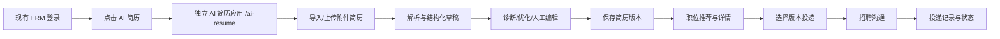

# HRM AI 简历与附件简历改造需求文档与开发计划

**版本**：V20260924.001（需求草案）  
**状态**：待产品决策冻结后开发  
**编制日期**：2026-09-24  
**所属范围**：`txgy-module-hrm`、`txgy-ui-admin-vben/apps/web-antd`，必要时同步 `web-ele`

## 0. 阅读说明与指令边界

### 0.1 本文档的依据

本文档按以下优先级解释需求：

1. 用户本次文字需求是最高优先级。
2. 用户提供的六张截图是视觉与信息架构参考，不是额外的操作指令；截图中的地址栏、示例姓名、职位和数据均不作为业务数据要求。
3. 现有 HRM 代码、SQL、菜单和交接文档是实现现状，不得反向改变本次需求。
4. `deephire.cn/jobseeker/home` 是外部参考站。实现采用自有代码、组件和可授权素材，不复制其源码、私有接口或未获授权的资源。参考网站：https://www.deephire.cn/jobseeker/home

### 0.2 明确的修改边界

本项目允许修改：

- `txgy-module-hrm` 后端、HRM SQL、HRM 菜单、HRM 文档和 HRM 测试。
- `txgy-ui-admin-vben/apps/web-antd` 中 HRM 个人端和 HRM 管理端页面、路由、API、样式和测试。
- 如两个前端实现存在同一 HRM 个人端入口差异，必要时同步 `web-ele`。

本项目严禁直接修改：

- `txgy-module-im`。
- 云培训学院、招标投标、BPM、CRM、ERP。
- 公共框架、公共登录/注册逻辑及与 HRM 无关的模块。

如招聘沟通必须依赖 IM：先提交《HRM 招聘沟通联调接口说明》，说明接口、原因、字段、权限、数据流和联调范围；在获得确认前只使用已有 HRM 能力或只完成接口适配层，不直接改动 `txgy-module-im`。

### 0.3 已确认方案与待确认项

以下方案已根据本轮产品确认写入计划：

| 决策项 | 已确认方案 | 影响 |
| --- | --- | --- |
| 前端形态 | 独立前端应用，部署到独立子域或独立路径；代码可先放在 `txgy-ui-admin-vben` 工作区内单独构建 | 需要独立构建入口、静态资源前缀、部署配置和认证上下文传递 |
| 登录 | 复用现有登录态、`user_id` 和 `tenant_id`，进入 AI 简历免登录 | 不改公共登录/注册逻辑 |
| 数据 | 纳入 HRM 数据库，所有新表包含 `tenant_id`、审计字段和软删除字段 | 可与现有个人简历、职位和投递建立 HRM 内关联 |
| AI 服务 | 接入 DeepSeek API；密钥只从服务端密钥管理或环境变量读取，模型、超时、重试和限额配置化 | 不把密钥写入前端、SQL、文档、日志或 Git |
| 附件简历制作 | 点击后直接跳转 AI 简历站的 `/ai-resume` 页面 | 不再维护第二套简历编辑/生成流程 |
| 参考站复刻程度 | 像素级对齐参考站的页面结构、间距、字号、颜色、图标、动效、状态和文案；采用自有实现 | 不依赖外站源码、iframe、运行时脚本或未授权素材 |
| 首期功能 | 完整覆盖求职助理、职位推荐、个人档案、AI 简历、Agent 设置、投递记录和招聘沟通 | 首期只做个人端，管理端后续补充 |
| HRM 联调 | 只通过现有 HRM 职位、投递和招聘沟通接口联调 | 不直接修改 `txgy-module-im` 或其他模块 |
| 交付节奏 | 先冻结本文档和分阶段计划，再按 Phase 实施 | 需求冻结前不进入大范围代码重构 |

仍需确认的事项仅包括：独立部署采用子域还是子路径、认证上下文的部署方式、DeepSeek 具体模型与额度、附件进入 `/ai-resume` 后是否自动开始解析、AI 代投是否开放，以及招聘沟通接口的现状口径。

## 1. 背景与目标

### 1.1 背景

当前 HRM 个人端已有在线求职资料、附件简历、简历版本和 AI 生成任务基础，但“AI 简历”和“附件简历制作”仍是两个相对独立的页面。新需求要求把 AI 简历升级为一个完整的求职者 AI 工作台，并将附件简历制作统一收敛到该工作台的简历 AI 页。

参考站的核心体验是：左侧固定导航、中央工作区、右侧 AI 助手或辅助面板，围绕职位推荐、个人档案、AI 简历、Agent 设置和投递记录形成连续求职流程。

### 1.2 目标

1. 登录后的 HRM 求职者点击“AI 简历”后，直接进入一个完整、连续、可返回招聘门户的 AI 简历子站。
2. 支持职位浏览与详情、求职资料、招聘沟通、简历投递、应聘记录等个人端功能，并让 AI 简历能力贯穿这些流程。
3. AI 简历支持附件解析、简历诊断、内容优化、结构化编辑、版本保存、预览和下载；AI 生成内容必须可编辑、可追溯、可重试。
4. “附件简历制作”只作为 AI 简历入口，不再形成独立的简历生成业务链路。
5. 后端和数据库能够承载异步 AI 任务、模型配置、用量、审计、错误重试和历史版本。
6. 不改变公共登录/注册，不修改被禁止的模块。

### 1.3 非目标

- 不复制 deephire.cn 的后端、私有 API、数据库或未授权素材。
- 不重建统一用户、租户、组织、权限、文件和消息基础设施。
- 不把 AI 简历数据写入 IM、培训、招投标、BPM、CRM 或 ERP 的业务表。
- 不在本期做企业端招聘算法、自动面试决策或自动淘汰候选人。

## 2. 现状基线

### 2.1 已有前端入口

当前 `web-antd` 已存在以下个人端路由和页面：

| 当前路径 | 当前用途 | 本期处理 |
| --- | --- | --- |
| `/portal/recruit` | 招聘门户、职位和个人简历聚合页 | 保留作为招聘入口；AI 简历按钮改为进入 AI 子站 |
| `/portal/recruit/resume/ai` | 现有 AI 简历生成页 | 改为跳转桥接页，直接进入独立应用 `/ai-resume` |
| `/portal/recruit/resume/attachment-builder` | 现有附件简历编辑器 | 改为直接跳转独立应用 `/ai-resume`，不再打开旧编辑器 |
| `/portal/recruit/detail` | 职位详情 | 复用职位详情能力或在 AI 子站提供统一详情视图 |
| `/portal/recruit/messages` | 招聘消息 | 复用 HRM 现有招聘沟通能力；如需 IM 联调先走接口说明 |
| `/portal/profile/recruit` | 求职资料 | 作为 AI 子站“个人档案”的数据来源和回写入口 |

实现前需以当前路由文件为准核对命名，禁止为了本需求修改公共路由注册机制。

### 2.2 已有 HRM 数据与服务

已存在或已在使用的基础对象包括：

- `hrm_personal_resume`：个人简历，支持附件（`resume_type=1`）和在线简历（`resume_type=2`）。
- `hrm_personal_resume_version`：个人简历不可变版本，支持父版本、来源职位、创建方式、内容指纹和幂等键。
- `hrm_recruit_resume`：企业侧候选人简历及投递快照，已有内容快照、来源个人版本和职位指纹扩展字段。
- `hrm_recruit_post`、职位类型和职位详情相关对象：职位浏览、职位详情和职位状态的事实来源。
- HRM 个人简历 Controller/Service、简历版本 Controller/Service、招聘 Agent 任务接口和文件上传接口。

现有 AI 生成任务可以作为任务执行基础，但需要补齐统一的任务模型、解析/诊断/优化类型、DeepSeek 配置、失败重试、用量记录和可观测性；管理端监控页面列入后续阶段。

## 3. 产品范围与信息架构

### 3.1 AI 简历独立应用入口

AI 简历应用作为独立前端构建目标部署到独立子域或独立路径，canonical 根路径固定为 `/ai-resume`。首期建议优先采用同主域子路径部署（例如 `https://<host>/ai-resume`），这样可以复用现有登录 Cookie；若采用子域（例如 `https://ai-resume.<host>`），必须由部署配置提供现有登录态的安全传递和 CORS/CSRF 约束，不能改公共登录/注册代码。

独立应用提供以下 canonical 路由：

| 路由 | 页面 | 必须能力 |
| --- | --- | --- |
| `/ai-resume` | 简历 AI 页（默认页） | 上传/选择来源、解析、诊断、优化、生成、结构化编辑、预览、版本 |
| `/ai-resume/home` | 求职助理 | 欢迎状态、对话输入、快捷动作、最近任务和侧栏导航 |
| `/ai-resume/recommend` | 职位推荐 | 求职偏好摘要、职位列表、筛选、推荐理由、职位详情和投递 |
| `/ai-resume/profile` | 个人档案 | 个人信息、求职意向、教育、工作、项目、技能、附件和保存 |
| `/ai-resume/settings` | Agent 设置 | 沟通话术、浏览器通知、AI 长期记忆、工作模式、账号操作 |
| `/ai-resume/applications` | 投递记录 | 全部、手动投递、AI 代投（若开放）、状态筛选和详情 |
| `/ai-resume/chat` | 招聘沟通 | HR 会话、消息、附件简历发送和会话状态 |
| `/ai-resume/job/:id` | 职位详情 | 完整职位信息、匹配摘要、投递和沟通入口 |

旧的 `/portal/recruit/resume/attachment-builder` 保留路由兼容，但只执行跳转：

```text
/portal/recruit/resume/attachment-builder
  -> /ai-resume
```

跳转不强制携带来源附件参数；进入 `/ai-resume` 后由用户从“简历 AI”页选择已有附件或上传新附件。若后续确认需要无感带入来源，可增加一次性、短期有效的 HRM 来源票据，不能把原文件地址或敏感字段拼接在公开 URL 中。

### 3.2 布局与视觉要求

以用户提供的参考图和外部参考站为交互基线：

- 左侧固定导航：品牌、求职助理、职位推荐、个人档案、AI 简历、Agent 设置、投递记录、用户入口，尺寸、折叠动效和选中态按参考站逐项对齐。
- 主区使用大面积留白、浅色背景、低圆角卡片、清晰的黑色标题和绿色/浅绿色强调色；实际颜色抽成 HRM 子站 token，不能散落硬编码。
- 首页使用底部或侧边 AI 输入区，提供快捷动作，例如深度搜索、职位推荐、简历优化和职场体验。
- 职位推荐使用可扫描的职位卡片，展示职位、薪资、城市、学历/经验、活跃时间、企业信息和投递按钮。
- 个人档案使用目录 + 详情结构，支持只读摘要、编辑入口、教育/经历时间线和头像/附件。
- AI 简历使用“来源文件/结构化内容/诊断结果/预览”并列或分步工作区，明确任务状态和 AI 生成内容标识。
- 响应式覆盖 1440px 桌面、1024px 平板和 390px 移动端；移动端将左侧导航折叠为抽屉，编辑与预览改为上下布局。
- 像素级验收覆盖视口、字体、字重、行高、间距、边框、阴影、图标、悬停/按下/加载/空状态和过渡动效；使用自有 CSS token 和组件实现。
- 不引用外站运行时脚本，不通过 iframe 嵌入外站页面，也不将外站作为运行时依赖。

### 3.3 求职者主流程



## 4. 功能需求

### 4.1 AI 首页/求职助理

**必须：**

- 展示当前用户称呼、简历完成度、最近简历版本、最近 AI 任务和推荐职位入口。
- 支持自然语言输入，至少识别职位搜索、简历优化、职位推荐和求职资料补充四类意图。
- 支持快捷动作，点击后进入对应页面并预填上下文。
- 对话消息区显示用户消息、AI 消息、引用的职位/简历版本和任务状态。
- AI 任务失败时显示可理解的失败原因、重试和返回编辑入口。
- 不让 AI 自动修改已保存简历；所有写入必须经过用户确认或明确的保存动作。

**建议：**

- 保留最近对话，默认按用户和租户隔离。
- 对职位推荐和简历诊断提供可点击的结果卡片，不只返回文本。

### 4.2 职位推荐、浏览和详情

- 从现有 HRM 职位事实源读取招聘中的职位；不复制职位数据到 AI 专用表，匹配结果另存。
- 支持关键词、城市、薪资、职位类型、学历、工作经验、职位状态等筛选。
- 职位卡展示职位名称、薪资、城市、学历/经验、活跃时间、企业/部门和投递入口。
- 职位详情展示任职要求、工作内容、工作地址、招聘人数、负责人/沟通入口和投递状态。
- 根据求职资料与当前简历版本生成匹配分数和解释；解释必须可追溯到职位字段和用户资料字段，不能展示不可解释的敏感推断。
- 投递前选择简历来源：在线简历、附件简历或已保存的个人简历版本。
- 重复投递、职位关闭、简历缺少必要信息时，前端提示由后端规则决定。

### 4.3 个人档案/求职资料

- 个人信息：姓名、头像、性别、出生年月、电话、邮箱、所在地。
- 求职意向：目标职位、城市、行业、薪资、工作性质、到岗时间。
- 教育经历、工作/实习经历、项目经历、技能、证书和附件。
- 显示资料完成度和缺失项；缺失项可从 AI 助手直接进入编辑。
- 保存沿用 HRM 个人求职资料接口和租户/用户校验，不修改公共账号资料逻辑。
- 联系方式在 AI 请求中默认不发送；只有用户确认投递或与招聘方沟通时才按权限使用。

### 4.4 简历 AI 页

#### 4.4.1 来源导入

- 选择现有附件简历、上传 PDF/DOC/DOCX，或使用在线求职资料。
- 上传后记录文件元数据、哈希、来源和解析任务状态。
- 文件类型、大小、病毒/安全检查和下载权限沿用 HRM 文件服务约束。
- 解析失败不覆盖原附件；显示失败原因并支持重试或手动建立结构化简历。

#### 4.4.2 结构化与编辑

- 将姓名、联系方式、求职目标、摘要、技能、工作经历、项目经历、教育经历、证书等映射为统一 JSON Schema。
- 每个字段可人工编辑；AI 生成字段显示“AI 生成”标识和来源任务。
- 允许添加、删除、排序和恢复版本；保存生成新的 `hrm_personal_resume_version`，不覆盖既有版本。
- 支持实时简历预览、模板切换、PDF/Word 下载和投递前预览。

#### 4.4.3 AI 诊断、优化和生成

- **诊断**：完整度、结构、关键词覆盖、可读性和职位匹配提示，返回分数、问题、证据和建议。
- **优化**：用户选择段落或整份简历，生成候选改写；用户确认后才写入草稿。
- **生成**：根据用户填写的目标、经历和职位，生成可编辑草稿；缺失事实不得由模型虚构。
- **职位定制**：以职位快照和简历版本为输入，给出针对该职位的内容建议；不直接代替投递确认。
- 每次任务包含幂等键、输入版本、模型、提示版本、耗时、token/用量（如供应商提供）、结果哈希和失败原因。

### 4.5 附件简历制作改造

- 入口按钮、导航和旧链接统一跳转到独立应用 `/ai-resume`。
- 不再执行旧 `attachment-builder.vue` 的独立模板编辑、Word 生成和保存流程。
- 目标页面默认让用户选择已有附件或上传附件；不在 URL 中暴露文件地址、手机号、邮箱或简历内容。
- 解析后的结构化结果可以保存为在线简历或不可变版本，并可重新生成附件文件。
- 历史已保存附件仍可在“我的简历”和投递选择器中使用，不做数据删除或批量迁移。

### 4.6 招聘沟通

- 在 AI 子站展示与 HRM 职位/应聘相关的会话、未读数、消息时间线和附件简历引用。
- 支持发送文本、选择简历版本、查看职位上下文和会话状态。
- AI 可生成建议回复，但发送必须由用户点击确认。
- 优先复用 HRM 现有招聘沟通接口；若现有能力实际落在 `txgy-module-im`，先输出联调说明，包含：会话标识、参与人、消息类型、附件授权、已读状态、撤回/删除口径、错误码和幂等策略。
- 本期不修改 `txgy-module-im`。

### 4.7 投递记录

- 支持全部、手动投递、AI 代投（只有产品确认开放时显示）分类。
- 展示职位、企业/部门、所用简历版本、投递时间、当前状态、最近沟通和下一步动作。
- 状态以 HRM 应聘事实源为准，前端不自行推断或覆盖状态。
- 详情显示职位快照、简历版本快照、投递来源、操作记录和沟通引用。

### 4.8 Agent 设置

- 沟通设置：默认自我介绍、期望表达风格、敏感信息是否自动带入。
- 浏览器通知：任务完成、职位推荐、招聘消息等通知开关。
- AI 长期记忆：可查看、编辑、清空；默认不记录身份证号、完整手机号等敏感字段。
- 工作模式：仅建议、用户确认后执行；若未来开放自动投递，必须单独授权、限额、可撤销并留痕。
- 账号注销入口沿用现有账号能力，不新增或修改公共注销逻辑；本页只展示入口和 HRM 数据清理说明。

## 5. 后端与接口计划

### 5.1 接口原则

- 所有接口位于 HRM 域，使用现有认证、租户上下文、分页、错误码和文件服务。
- `tenant_id`、`user_id` 从服务端上下文获取，不接受前端任意传入作为权限依据。
- 所有写操作支持幂等键；AI 任务使用业务键 + 输入指纹防止重复扣费和重复写版本。
- AI 任务采用异步模型：提交返回任务 ID，前端轮询或通过现有通知能力刷新状态。
- 敏感字段默认脱敏；导出和原文件下载单独鉴权并记录审计。

### 5.2 个人端接口（建议路径）

| 编号 | 方法 | 路径 | 用途 |
| --- | --- | --- | --- |
| AI-P-01 | `GET` | `/hrm/portal/ai-resume/workspace` | 首页摘要、完成度、最近任务和最近版本 |
| AI-P-02 | `GET/PUT` | `/hrm/portal/ai-resume/profile` | 读取/保存求职资料 |
| AI-P-03 | `GET` | `/hrm/portal/ai-resume/jobs` | 职位推荐与筛选 |
| AI-P-04 | `GET` | `/hrm/portal/ai-resume/jobs/{id}` | 职位详情和匹配摘要 |
| AI-P-05 | `POST` | `/hrm/portal/ai-resume/sources` | 登记附件/在线资料作为 AI 来源 |
| AI-P-06 | `POST` | `/hrm/portal/ai-resume/tasks/parse` | 提交附件解析任务 |
| AI-P-07 | `POST` | `/hrm/portal/ai-resume/tasks/diagnose` | 提交简历诊断任务 |
| AI-P-08 | `POST` | `/hrm/portal/ai-resume/tasks/optimize` | 提交优化任务 |
| AI-P-09 | `POST` | `/hrm/portal/ai-resume/tasks/generate` | 提交生成任务 |
| AI-P-10 | `GET` | `/hrm/portal/ai-resume/tasks/{id}` | 查询任务状态和结果 |
| AI-P-11 | `POST` | `/hrm/portal/ai-resume/versions` | 确认并保存简历版本 |
| AI-P-12 | `GET` | `/hrm/portal/ai-resume/versions` | 查询版本列表 |
| AI-P-13 | `GET` | `/hrm/portal/ai-resume/versions/{id}` | 查询版本详情 |
| AI-P-14 | `POST` | `/hrm/portal/ai-resume/versions/{id}/export` | 生成 PDF/Word 下载任务 |
| AI-P-15 | `POST` | `/hrm/portal/ai-resume/applications` | 选择职位和版本投递 |
| AI-P-16 | `GET` | `/hrm/portal/ai-resume/applications` | 查询投递记录 |
| AI-P-17 | `GET/PUT` | `/hrm/portal/ai-resume/settings` | 读取/保存 Agent 设置 |
| AI-P-18 | `GET/POST` | `/hrm/portal/ai-resume/chat/*` | AI 对话与招聘沟通适配 |

现有 `/hrm/portal/recruit/agent/*`、`/hrm/portal/resume/*` 接口在迁移期保留兼容；新增接口稳定后再评估收敛，不能一次性删除旧接口。

### 5.3 管理端接口（建议路径）

管理端仅在确认建设管理功能后实施：

- `/hrm/admin/ai-resume/providers`：AI 供应商和模型配置，密钥使用现有安全配置或密钥引用，不回显明文。
- `/hrm/admin/ai-resume/prompts`：提示词版本、发布、回滚和适用任务。
- `/hrm/admin/ai-resume/tasks`：任务查询、失败重试、取消和错误详情。
- `/hrm/admin/ai-resume/usage`：按租户、用户、模型、任务类型统计用量和费用估算。
- `/hrm/admin/ai-resume/templates`：简历模板和导出配置。
- `/hrm/admin/ai-resume/audits`：敏感操作、模型调用和数据导出审计。

## 6. 数据库设计计划

### 6.1 复用对象

| 对象 | 复用口径 |
| --- | --- |
| `hrm_personal_resume` | 继续作为个人附件/在线简历事实记录；不改变现有 `resume_type` 语义 |
| `hrm_personal_resume_version` | 作为用户确认后的不可变简历版本；新增 `create_type` 枚举值前先核对现有代码 |
| `hrm_recruit_post` | 职位事实源，AI 只存匹配和快照，不改职位主表语义 |
| `hrm_recruit_application` | 投递事实源；AI 入口带来源和简历版本，历史投递不重写 |
| `hrm_recruit_resume` | 企业侧投递快照；投递时固化个人版本内容和职位指纹 |
| HRM 文件服务 | 原文件上传、下载、权限、哈希和存储地址 |

### 6.2 新增表建议

所有新表默认包含：`id`、`tenant_id`、`creator`、`create_time`、`updater`、`update_time`、`deleted`；按用户维度建立唯一键或复合索引。

| 表名 | 主要字段 | 作用 |
| --- | --- | --- |
| `hrm_ai_resume_workspace` | `user_id`、`current_version_id`、`completion_rate`、`last_opened_at` | AI 子站工作台摘要和当前版本指针 |
| `hrm_ai_resume_source` | `user_id`、`source_type`、`personal_resume_id`、`file_url`、`file_hash`、`parse_status`、`content_json` | 附件/在线资料的解析来源与结构化内容 |
| `hrm_ai_resume_task` | `user_id`、`task_type`、`source_id`、`input_version_id`、`provider`、`model`、`prompt_version`、`status`、`request_hash`、`result_json`、`error_code`、`retry_count` | 统一承载解析、诊断、优化、生成、导出任务 |
| `hrm_ai_resume_diagnosis` | `user_id`、`resume_version_id`、`post_id`、`score`、`dimensions_json`、`findings_json` | 保存诊断结果和证据 |
| `hrm_ai_resume_job_match` | `user_id`、`post_id`、`resume_version_id`、`score`、`reason_json`、`generated_at` | 保存职位匹配结果，支持缓存和解释 |
| `hrm_ai_resume_chat_session` | `user_id`、`session_type`、`post_id`、`application_id`、`status`、`last_message_at` | AI 对话或 HRM 招聘沟通的业务会话索引 |
| `hrm_ai_resume_chat_message` | `session_id`、`sender_type`、`message_type`、`content`、`reference_json`、`read_at` | AI 会话消息；HRM/IM 外部消息只存引用和同步状态 |
| `hrm_ai_agent_setting` | `user_id`、`communication_json`、`notification_json`、`memory_json`、`work_mode` | Agent 设置与用户偏好 |
| `hrm_ai_resume_template` | `name`、`template_key`、`schema_version`、`preview_url`、`status`、`sort` | 简历模板版本管理 |
| `hrm_ai_provider_config` | `provider_key`、`model`、`endpoint_ref`、`secret_ref`、`quota_json`、`status` | 管理端 AI 供应商配置，不存明文密钥 |
| `hrm_ai_prompt_version` | `task_type`、`version`、`template`、`variables_schema`、`status`、`published_at` | 提示词版本和回滚 |
| `hrm_ai_usage_record` | `task_id`、`user_id`、`provider`、`model`、`input_tokens`、`output_tokens`、`duration_ms`、`estimated_cost` | 用量、性能和费用统计 |
| `hrm_ai_audit_log` | `user_id`、`operator_type`、`action`、`target_type`、`target_id`、`before_json`、`after_json`、`trace_id` | AI 调用、导出、重试、设置变更和敏感操作审计 |

### 6.3 状态与一致性规则

- 任务状态：`PENDING` → `RUNNING` → `SUCCEEDED` / `FAILED` / `CANCELED`。
- 来源解析状态：`UPLOADED`、`PARSING`、`PARSED`、`PARSE_FAILED`。
- AI 任务不得直接覆盖 `hrm_personal_resume_version`；用户确认后才创建版本。
- 投递时固化 `resume_version_id`、职位指纹和内容哈希；后续编辑不影响历史投递。
- 同一用户、同一任务类型、同一输入哈希在幂等窗口内不得重复创建有效任务。
- 任务失败可重试，重试必须生成审计记录；超过最大次数进入人工处理队列。
- `tenant_id` 与登录用户租户必须一致；所有查询同时校验 `user_id` 或岗位数据权限。

### 6.4 SQL 交付

新增一个递增编号的 HRM 增量脚本，例如 `txgycloud/deploy/mysql/init/010x-hrm-ai-resume.sql`，内容包括：

1. 新表建表、索引、唯一键和字段注释。
2. HRM 管理端菜单、按钮权限和字典（若菜单采用 SQL 初始化）。
3. 兼容已有库的条件变更和回滚说明。
4. 测试库建表脚本同步更新。
5. 不修改或重建非 HRM 表，不直接覆盖生产数据。

正式编号在实施前根据当前 init 目录最大编号确定，避免与并行 SQL 冲突。

## 7. 菜单与权限计划

### 7.1 个人端

个人端 AI 子站导航属于登录后 HRM 个人端路由，不新增公共登录菜单。访问必须满足：

- 已登录；
- 当前用户具有 HRM 个人端访问能力；
- 所有数据按 `tenant_id + user_id` 隔离。

### 7.2 管理端（确认建设后）

建议挂在“HRM 管理端 > 招聘管理 > AI 简历”，权限标识示例：

| 菜单/按钮 | 权限标识示例 |
| --- | --- |
| AI 简历任务 | `hrm:ai-resume:task:query` |
| 任务重试/取消 | `hrm:ai-resume:task:operate` |
| 模型配置 | `hrm:ai-resume:provider:manage` |
| 提示词管理 | `hrm:ai-resume:prompt:manage` |
| 模板管理 | `hrm:ai-resume:template:manage` |
| 用量与审计 | `hrm:ai-resume:audit:query` |

权限命名必须先检索现有 HRM 菜单，避免与 `hrm:recruit:*` 或其他模块重复。菜单 SQL 只写 HRM 菜单，不触碰公共菜单和其他模块菜单。

## 8. 前端实施计划

### Phase 0：需求冻结与参考基线

- 固化已确认的像素级复刻、独立应用、现有登录、DeepSeek、完整侧栏功能、HRM 内联调和首期不做管理端。
- 确认独立部署采用子域还是子路径、认证上下文传递方式、DeepSeek 具体模型与额度、附件是否自动开始解析和是否开放 AI 代投。
- 对参考站进行页面、交互、字段和状态清单整理；只记录可公开观察到的行为。
- 以当前开发服务器 `http://127.0.0.1:5666/` 建立截图基线。
- 输出：冻结版需求、路由表、接口草案、字段 Schema、视觉 token 表。

### Phase 1：AI 子站壳与入口收敛

- 创建独立 AI 简历前端构建目标、`AiResumeShell`、侧栏、顶部用户区、响应式导航和页面级错误/加载/空状态。
- 配置独立子域或 `/ai-resume` 子路径的静态资源前缀、API 地址、回退路由和认证上下文读取。
- `web-antd` 的“AI 简历”入口跳转独立应用默认页。
- “附件简历制作”改为直接重定向到 `/ai-resume`，不再进入旧编辑器。
- 保留旧链接兼容和返回招聘门户能力。
- 验收：桌面/移动端导航、登录态传递、刷新、浏览器前进后退、独立部署地址和旧链接兼容。

### Phase 2：简历 AI 核心

- 来源选择、附件上传、解析状态、结构化编辑、诊断结果、优化草稿、版本保存和预览。
- 对接现有个人简历、简历版本、文件上传和 AI 任务接口。
- 将旧 `resume-ai.vue` 和 `attachment-builder.vue` 的重复能力收敛到新页面/组件。
- 验收：上传失败、任务重试、重复点击、版本幂等、字段编辑和历史投递快照。

### Phase 3：职位、档案、投递和沟通

- 职位推荐、职位详情、匹配理由、简历选择投递。
- 个人档案目录和编辑。
- 投递记录筛选、详情和状态时间线。
- 招聘沟通入口；若依赖 IM，先完成接口说明和只读/适配范围确认。

### Phase 4：DeepSeek 接入、安全与可观测性

- 服务端接入 DeepSeek，密钥通过部署环境变量或密钥管理系统注入；前端不得接触密钥。
- 任务监控、失败重试、用量统计、审计、提示词版本和配额先以内置 HRM 配置/日志完成。
- AI 任务超时、限流、配额、敏感数据屏蔽和错误告警。
- 管理端模型/提示词/模板配置页面列入后续 Phase，不作为首期个人端完成条件。

当前实现进度：HRM 服务端已支持通过环境变量切换 DeepSeek/OpenAI 兼容模型；密钥不落前端、SQL 或日志；超时、最大重试次数和退避参数可配置；瞬态 HTTP 错误有限重试；任务记录模型、提示词版本、耗时和 token 用量，成功结果保存 SHA-256 指纹；失败和成功日志仅输出任务元数据并携带 traceId。管理端配置页面和招聘沟通仍不在本阶段范围内。

### Phase 5：测试、文档与交付

- 前端类型检查、单元测试、Playwright 关键路径、后端单测/集成测试和 SQL 验证。
- 在 Vite 热更新环境完成桌面/移动视觉验收。
- 更新 HRM 文档、SQL 变更说明、接口说明和部署/重构 Docker 前置检查。

## 9. 后端实施计划

1. 抽取统一 `HrmAiResumeTask` 聚合和任务状态机，兼容已有招聘 Agent 任务。
2. 增加来源解析服务、结构化 Schema 校验、结果清洗和敏感字段过滤。
3. 增加 DeepSeek Provider 适配接口；模型、超时、重试、限流和配额全部配置化。DeepSeek API key 只通过服务端密钥管理或环境变量注入，严禁写入前端、SQL、文档、日志和 Git。
4. 增加诊断/优化/生成/职位匹配服务；每个任务都记录输入版本和结果哈希。
5. 增加简历版本确认、导出任务、投递快照和审计。
6. 预留管理端查询、重试、用量和配置接口，但首期不建设管理端页面；必要的运维能力通过受控配置和日志完成。
7. 增加定时任务：超时任务回收、失败重试、过期会话清理、用量汇总和通知补偿。

## 10. 测试与验收

### 10.1 功能验收清单

| 编号 | 场景 | 验收标准 |
| --- | --- | --- |
| AC-01 | 点击 AI 简历 | 登录后直接进入新 AI 简历子站，侧栏和默认页完整，刷新不丢失用户上下文 |
| AC-02 | 点击附件简历制作 | 直接到简历 AI 页，不再打开旧编辑器；来源附件可识别或可重新选择 |
| AC-03 | 上传附件 | PDF/DOC/DOCX 校验、上传、解析状态和失败重试可用；原文件不被覆盖 |
| AC-04 | AI 生成 | 任务异步执行，展示状态、错误和重试；生成内容可编辑且不会自动写入已保存版本 |
| AC-05 | 保存版本 | 重复点击不产生重复版本；版本有来源、哈希、创建方式和时间 |
| AC-06 | 职位详情/投递 | 职位关闭、重复投递、无简历和权限不足均由后端规则返回可理解提示 |
| AC-07 | 投递快照 | 投递后修改个人简历不会改变历史投递内容 |
| AC-08 | 求职资料 | 个人、意向、教育、工作、项目、技能保存和回显一致，租户/用户隔离有效 |
| AC-09 | 招聘沟通 | 消息、未读、简历引用和错误态符合已确认的 HRM/IM 联调契约 |
| AC-10 | 设置与记忆 | 设置可保存、可查看、可清空；敏感字段不会默认发送给 AI |
| AC-11 | 管理端 | 首期不以管理端页面为验收条件；后续建设时再验收模型/提示词/任务/用量/审计权限和操作日志 |
| AC-12 | 禁止范围 | 变更集不包含 `txgy-module-im`、培训、招投标、BPM、CRM、ERP 和公共登录/注册逻辑 |

### 10.2 自动化测试

- 前端：路由访问、重定向、权限守卫、任务轮询、错误/空状态、版本保存和关键组件单测。
- Playwright：桌面端和移动端覆盖 AI 首页、附件入口、上传、生成、保存、职位详情、投递、返回招聘门户。
- 后端：任务状态机、幂等、租户隔离、用户隔离、敏感字段过滤、版本快照、重复投递和文件权限。
- SQL：新库初始化、已有库增量升级、重复执行保护、索引/唯一键和测试数据清理。
- 联调：只对已批准的 HRM 接口和已存在的招聘沟通接口做契约测试；不得以测试名义修改受限模块。

### 10.3 视觉验收

在 `http://127.0.0.1:5666/` 热更新环境至少验证：

- 1440×900：完整侧栏、中央工作区、右侧辅助区不重叠。
- 1024×768：导航和编辑区域可用，表单不会横向溢出。
- 390×844：侧栏折叠、表单单列、预览可滚动、按钮和文字不裁切。
- 加载、空数据、解析中、成功、失败、权限不足和网络重试状态。

## 11. 风险、约束与处理

| 风险 | 处理 |
| --- | --- |
| 外部参考站改版或不可访问 | 以已确认的截图、页面清单和本地视觉 token 为准，不把外站作为运行时依赖 |
| AI 生成虚构经历 | 输入 Schema 校验、事实来源引用、结果标记和用户确认；提示词禁止补造事实 |
| AI 服务超时/费用失控 | 异步任务、超时回收、重试上限、用户/租户配额和用量审计 |
| 附件包含敏感信息 | 文件权限、下载审计、解析前脱敏策略和最小化发送字段 |
| 个人简历与投递数据不一致 | 投递时固化版本和职位指纹，历史事实不回写 |
| 招聘沟通依赖 IM | 先出联调接口说明；本期不修改 `txgy-module-im` |
| 与现有 AI Agent 重复建模 | 先盘点现有 Agent 表和服务，采用兼容扩展或迁移适配，不复制同义事实 |
| 路由/菜单影响其他模块 | 只新增 HRM 路由和 HRM 菜单，执行变更集扫描和回归测试 |

## 12. 交付物与完成定义

### 12.1 交付物

1. 本需求文档冻结版和决策记录。
2. 独立 AI 简历前端构建目标、`web-antd` HRM 入口重定向及必要的 `web-ele` 同步。
3. `txgy-module-hrm` 后端接口、任务执行、数据对象、权限和测试。
4. HRM SQL 增量脚本、测试库脚本和菜单初始化脚本。
5. HRM API/联调说明、AI Provider 配置说明、错误码和运维说明。
6. Playwright/后端测试报告、桌面/移动截图和 Vite 热更新验证记录。

### 12.2 完成定义

- 个人端核心流程从登录、AI 简历入口、附件解析、编辑、保存版本、职位投递到投递记录可闭环。
- 所有异步任务可观察、可重试、可审计，失败不会破坏已有简历和投递事实。
- 数据租户隔离、用户隔离、文件权限和敏感字段规则通过自动化测试。
- 旧附件简历数据可继续查看和投递；旧入口不再打开重复编辑器。
- 变更集仅落在允许的 HRM 前后端、HRM SQL、HRM 菜单、HRM 文档和测试范围内。
- 在热更新环境完成指定分辨率的功能与视觉验收后，才进入 Docker 重构/重建。

## 13. 待产品确认的问题

以下项目仍需在开发前确认，答案写入 V20260924.002 冻结版：

1. 独立部署采用同主域子路径还是独立子域？若采用子域，现有登录态通过哪种已批准的安全票据或 Cookie 规则传递？
2. DeepSeek 使用的具体模型、单用户/租户额度、并发上限和成本告警阈值是什么？
3. 附件进入 `/ai-resume` 后是进入解析准备态，还是自动开始解析？
4. 是否开放 AI 代投；如果开放，授权、限额、撤销和审计规则是什么？
5. 现有 HRM 招聘沟通接口是否已覆盖会话、消息、未读和附件简历引用；若不足，需先冻结哪份 HRM 联调契约？

> 安全记录：本轮沟通中曾提供 DeepSeek API key。该凭据不写入本文档、代码、SQL、日志或版本库；实施时必须从服务端环境变量或密钥管理系统读取，并建议在开发前轮换已暴露的 key。
