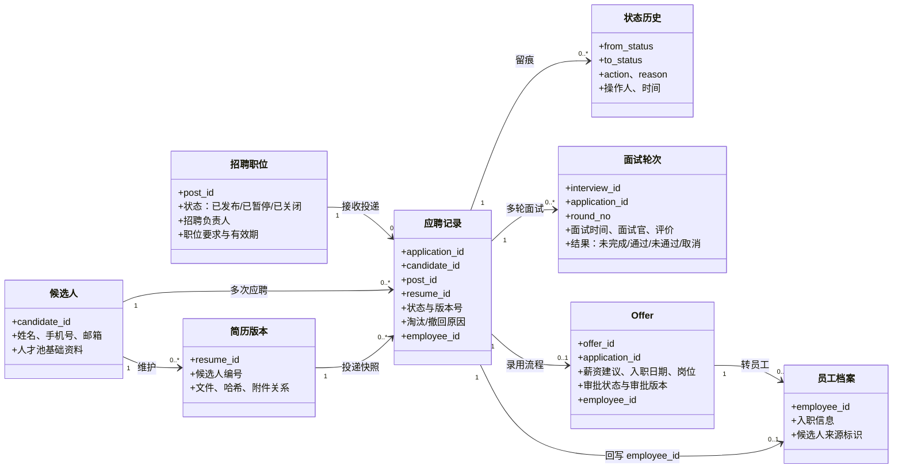
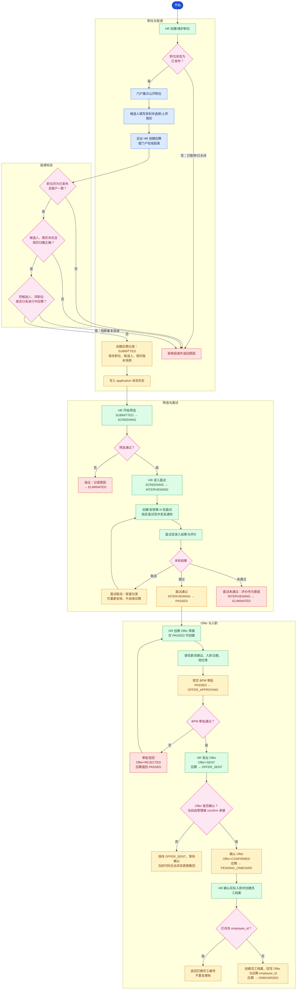
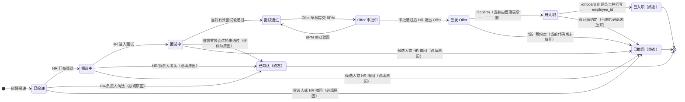
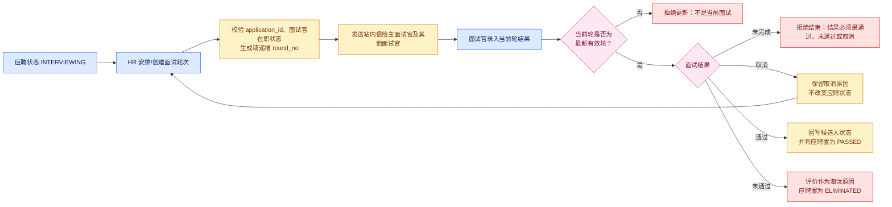
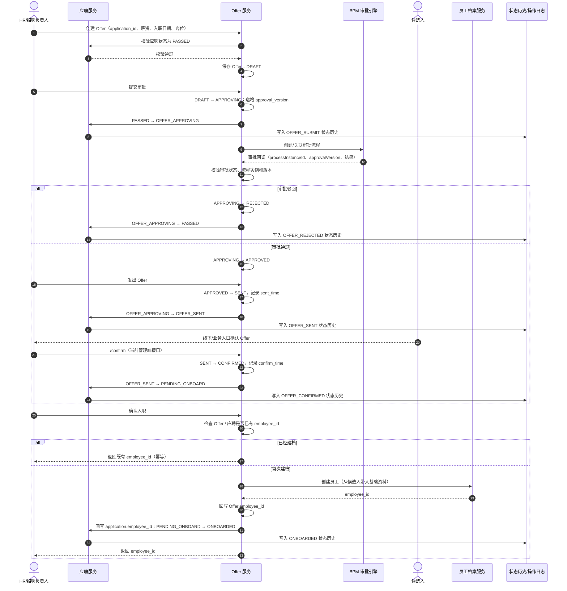
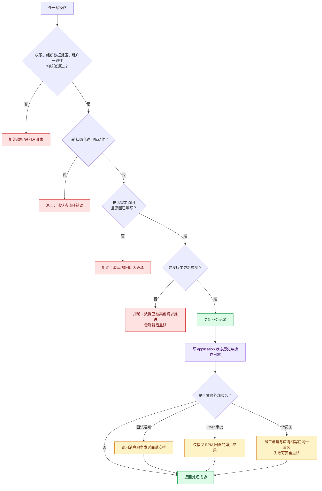
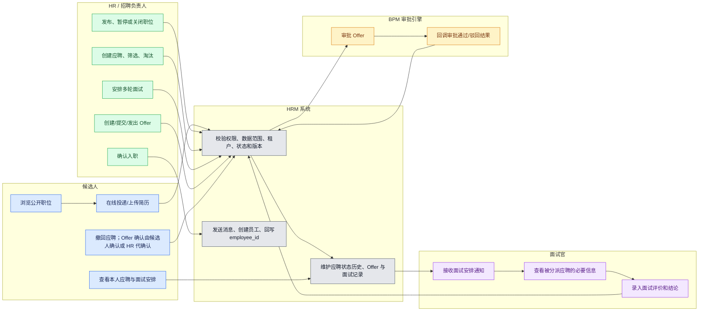

# HRM 招应聘模块详细流程图

**依据**：当前 HRM 招聘模块后端实现及其第二组设计稿。  
**范围**：职位发布、候选人/简历、投递、筛选、多轮面试、Offer、录用转员工。  
**核心聚合根**：`application`（应聘记录）；同一候选人可应聘多个职位，同一应聘可包含多轮面试，但最多关联一份有效 Offer。

> 图中“门户”指外部候选人使用的公开招聘入口；“后台”指 HR、部门负责人和面试官使用的管理端。应聘状态变更由服务层统一校验并记录状态日志，前端不能直接改写状态。

## 1. 业务对象与关联关系

## 2. 招应聘端到端主流程

## 3. 应聘状态机

**进行中状态**：`SUBMITTED`、`SCREENING`、`INTERVIEWING`、`PASSED`、`OFFER_APPROVING`、`OFFER_SENT`、`PENDING_ONBOARD`。同一租户、同一候选人、同一职位存在进行中记录时，系统阻断再次投递；进入 `ONBOARDED`、`ELIMINATED` 或 `WITHDRAWN` 后，如需再次应聘必须新建记录。

## 4. 多轮面试与状态回写流程

> 当前实现会根据当前有效面试轮的通过/未通过结果立即回写应聘状态；面试记录支持按 `application_id` 递增轮次，但“通过后是否仍允许追加面试、何时达到录用条件”（单轮、末轮或全部轮次）仍需产品冻结并补齐一致性规则。

## 5. Offer 审批与转员工时序

## 6. 关键控制点与异常分支

| 控制项 | 当前规则 |
| --- | --- |
| 职位可投递性 | 仅“已发布”职位可新增投递；暂停或关闭均拒绝新增投递，历史流程可继续查询和完成。 |
| 重复投递 | 事务内检查同租户、同候选人、同职位的进行中应聘，不用永久唯一约束阻断历史再次投递。 |
| 状态一致性 | 应聘状态仅由服务层流转；每次创建、筛选、淘汰、撤回、面试结论、Offer、入职均写状态历史。 |
| 并发保护 | 应聘状态流转携带 `version` 乐观锁；Offer 审批回调使用流程实例和审批版本实现幂等。 |
| 转员工幂等 | Offer 或应聘已回写 `employee_id` 时直接返回既有编号，避免重复创建员工。 |
| 数据与隐私 | 以租户和授权组织范围隔离数据；手机号、证件号默认脱敏；面试评价只向授权人员展示；导出单独授权并留痕。 |
| 当前实现差异 | `OFFER_SENT/PENDING_ONBOARD → WITHDRAWN` 已在设计稿中提出，但当前 `HrmRecruitApplicationServiceImpl.isAllowed()` 未开放；Offer `/confirm` 及门户撤回均由后端权限接口承接，候选人独立确认入口仍待补齐。 |

## 7. 角色泳道

## 8. 当前接口映射

| 流程环节 | 当前接口 | 说明 |
| --- | --- | --- |
| 公开职位浏览 | `GET /hrm/portal/recruit/post/page`、`GET /hrm/portal/recruit/post/get` | 仅查询已发布职位；公开接口跨租户读取。 |
| 门户在线投递 | `POST /hrm/portal/recruit/application/create` | 服务端按登录用户/手机号查找或创建候选人，复制简历到招聘简历并生成 `SUBMITTED`。 |
| 我的应聘 | `GET /hrm/portal/recruit/application/page`、`GET /hrm/portal/recruit/application/get` | 仅返回当前登录候选人的应聘、面试和 Offer 信息。 |
| 门户撤回 | `PUT /hrm/portal/recruit/application/withdraw` | 由后端再次执行状态流转和原因必填校验。 |
| 后台创建/查询应聘 | `POST /hrm/recruit/application/create`、`GET /hrm/recruit/application/page`、`GET /hrm/recruit/application/get` | 创建前校验候选人、职位、简历归属和进行中重复投递。 |
| 筛选与应聘状态 | `PUT /hrm/recruit/application/start-screening`、`/enter-interview`、`/eliminate`、`/withdraw` | 服务层按当前状态和 `version` 乐观锁更新，并写状态日志。 |
| 面试安排与结果 | `POST /hrm/recruit/interview/create`、`PUT /update`、`PUT /update-result`、`GET /get`、`GET /list-by-candidate`、`DELETE /delete` | 面试优先关联 `application_id`，按 `round_no` 支持多轮；当前有效轮结果回写应聘状态。 |
| Offer 草稿与审批 | `POST /hrm/recruit/offer/create`、`PUT /submit`、`PUT /approval-callback`、`PUT /withdraw` | `PASSED` 才能创建；BPM 回调校验 `processInstanceId + approvalVersion`。 |
| Offer 发出/确认 | `PUT /hrm/recruit/offer/send`、`PUT /hrm/recruit/offer/confirm` | `APPROVED → SENT → CONFIRMED`，分别回写 `OFFER_SENT`、`PENDING_ONBOARD`。 |
| 转员工 | `PUT /hrm/recruit/offer/onboard` | 复用员工建档服务；按 Offer 和 `application_id` 的 `employee_id` 幂等。 |

## 9. 待业务确认的流程节点

下列节点在实现中已预留，但尚需企业确认后作为最终规则冻结：

1. 同职位再次投递的冷却期，以及候选人撤回后的再次投递限制；
2. 面试通过的判定口径：单轮、末轮或全部轮次通过；
3. Offer BPM 审批节点、审批人来源、Offer 有效期及候选人确认方式；
4. `OFFER_SENT` 到 `PENDING_ONBOARD` 是否必须完成电子签署；
5. 转员工时是否自动创建平台账号、员工编号规则及失败补偿责任方；
6. 历史面试记录补齐 `application_id` 与 `round_no` 的迁移策略。
