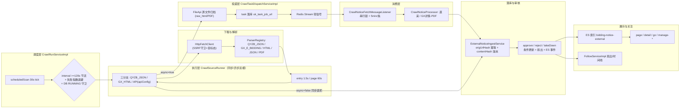

# 外部公告域技术方案：架构·安全·幂等·版本化·状态机·去重（2026-09-09）

> 定位：外部公告采集与展示域（notice 分支）的**目标态技术方案**，供收尾整改与后续迭代遵循。
> 三个上游文档分工：《../../txgy-module-bidding/docs/外部公告采集与展示设计方案.md》（v0.6，需求与总体口径，不动）、
> 《后端审查-2026-09-09-外部公告域逻辑bug与风险清单.md》（缺陷证据，下称《审查》）、本文（六维度目标态设计，整改项与《审查》条目互链）。
> 代码基线：`txgy-module-bidding-server/.../bidding/service/{externalfetch,noticeexternal,noticefollow}`（约 6.5k 行，2026-09-09 通读）。
> 表名前缀惯例：镜像表 `bidding_std_*`、业务表 `bidding_<域>_<实体>`（开发规范第五章）；错误码段 1-060-106。

---

## 一、域定位与轨道边界

| 项 | 结论 |
| --- | --- |
| 域职责 | 采集外部依法公开公告（秦源/国信/API 直取）→ 人工审核 → 进大厅面向社会展示；登录用户可关注（公告/项目/招标项目/标段）并接收动态 |
| G 轨（平台级） | `bidding_fetch_source / bidding_fetch_task / bidding_fetch_job / bidding_notice_external(+附件子表)`，@TenantIgnore；管理页=平台职能（爬虫管理/外部公告审核），勿授企业租户 |
| T 轨（用户级） | 关注域 4 表（subscription/follow_item/item_event/…），拦截器隔离（v0.6 §十五修订，回归 T 轨） |
| 与内部 notice 关系 | 自营公告走内部 notice 模块发布，**不进外部大厅**；两源公告统一汇入关注域扇出（`handleNoticeActivated` / 内部 `fanoutInternal`） |
| 不做的事 | 不做 Python 微服务（v0.3 已否）；不做业务表 LIKE 检索（红线 4.6，keyword 一律走 ES）；AI 侧深重试交给 AI 服务方 |

## 二、总体架构



分层职责一句话版：**调度管"什么时候爬"，执行管"怎么爬"，投递把"大文本"文件化后只传轻信号，消费按 5 分钟/条慢速落库，落库层做幂等与版本判定，审核是唯一的新→ACTIVE 闸口，展示侧只信 ACTIVE+SOCIAL+净化输出。**

## 三、数据模型（关键列速查）

| 表 | 关键列 | 约束/语义 |
| --- | --- | --- |
| `bidding_fetch_source` | `source_code`(uk)、`base_url`、`allowed_hosts`、`entry_urls_json`、`fetch_type`(CRAWLER/API)、`api_config_json`、`parser_code_default`、`fetch_interval_seconds`、`robots_ok`、`enabled` | 保存即校验（URL 协议/通道注册/interval≥120s）；启用源=外链 /go 白名单成员 |
| `bidding_fetch_task`（CrawlTaskDO） | `job_id`、`url_hash`、`status`、`attempt`、`next_retry_time`、`worker_id`、`payload_json` | uk `uk_task_job_url(job_id,url_hash)`；payload 只存引用不存大文本 |
| `bidding_fetch_job`（CrawlJobDO） | `source_code`、`trigger_type`(MANUAL/SCHEDULE)、`status`、`produced`、`summary_json` | RUNNING 为互斥标志位；`produced`=投递完成标记（收尾竞态防护） |
| `bidding_notice_external` | `orig_url`(uk hash=`orig_url_hash`)、`content_hash`、`status`、`audit_status`、`public_scope`、`content_html`、`pdf_file_id/pdf_sha256/pdf_size`、`extraction_status`、`ai_extraction_status/ai_meta_json`、`body_blocks_status/body_blocks_json/body_parser_code`、`industry_flag/industry_confidence`、`publish_time`、`fetch_count`、`last_fetch_time` | PDF 红线 8：三要素齐存；公开出参 `content_html` 恒 null，只出净化版 |
| 附件子表 | `notice_id`、`file_id`、`sha256`、`size`、`orig_download_url`、`virus_status` | 入库即 PENDING；INFECTED 不下发链接 |
| 关注域 4 表（T 轨） | `user_id/tenant_id`、`target_type/target_key`、`display_name/issuer_name`（快照）、`stage_code`、`unread_count`、`event_key`(uk) | 行快照建行即回查补名；跨轨只读 notice 主档不写 |

## 四、状态机（三个，全部条件更新守卫）

### 4.1 公告状态机（status × audit_status 二维）

| 转移 | 触发 | 守卫（UPDATE where 子句） |
| --- | --- | --- |
| NEW+UNREVIEWED → ACTIVE+APPROVED | `POST /notice-external/approve` | `id=? AND status='NEW' AND audit_status='UNREVIEWED'` |
| NEW+UNREVIEWED → NEW+REJECTED | reject | 同上 |
| ACTIVE+APPROVED → INACTIVE+TAKEN_DOWN | take-down | `status='ACTIVE' AND audit_status='APPROVED'` |
| 任意 → NEW+UNREVIEWED | 同 URL 内容变化重投（ingest 覆盖分支） | urlHash 命中即覆盖（防源站投毒直接公开展示的设计点） |

要点：rows=0 即抛 `EXTERNAL_NOTICE_STATE_INVALID`（旧快照不参与写回）；恢复展示的唯一入口=同 URL 重新采集进审核；approve 幂等（已 ACTIVE+APPROVED 直接返回）。**takeDown 目标态需补 ES 删除/更新事件与关注侧下线扇出**（《审查》§三）。

### 4.2 任务状态机（CrawlTaskDO）

```
PENDING --markRunning--> RUNNING --成功--> SUCCESS(终态)
                            └--失败--> attempt+1 < 3 → PENDING(next_retry_time=now+2^n分钟)
                                      attempt = 3 → FAILED(死信) + crawl.audit 出口
FAILED --人工 retryTask--> PENDING(attempt=0, 保留原 message 前缀)
```

目标态补两刀（《审查》§A3）：①**PENDING 到期重投扫描**（tick 内 `status='PENDING' AND next_retry_time<=now` 重发轻信号——当前断链，失败一次=源停摆）；②消费侧执行前校验 `next_retry_time`（防消息重投击穿退避）。

### 4.3 批次状态机（CrawlJobDO）

```
插入 RUNNING --async 同步直抓--> finishJob(SUCCESS/PARTIAL/FAILED)
插入 RUNNING --async 投递--> produced=TRUE --tryFinalizeJob(无 PENDING/RUNNING task)--> 收尾
空跑(0/0) --> 直接 SUCCESS（不留 RUNNING 孤儿）
启动自愈：孤儿 RUNNING(无未终态 task) → FAILED(interrupted)；RUNNING task → PENDING + 重发信号
```

要点：`produced` 守卫防"投递未完成被提前收尾"；收尾只在 RUNNING 状态执行一次（幂等）；summary 按 task 终态计 SUCCESS/PARTIAL/FAILED（SKIPPED 不计失败）。

## 五、幂等设计（五道防线）

| # | 层 | 机制 | 代码锚点 |
| --- | --- | --- | --- |
| 1 | 接口 | `@Idempotent` 覆盖全部写端点（run/create/update/enabled/delete/approve/…） | CrawlSourceController / NoticeExternalController |
| 2 | 任务 | `uk_task_job_url` 唯一键 + 布隆前置（`@ConditionalOnProperty` 二选一：local 默认 / redis 多节点）+ 未终态复用；撞键回退 DB 复核 | CrawlTaskServiceImpl.createTaskIfAbsent |
| 3 | 内容 | `uk orig_url_hash` + DuplicateKeyException 回读走幂等/重投分支（并发双投安全） | ExternalNoticeIngestServiceImpl.ingest |
| 4 | 审核 | 条件更新（§4.1 守卫），并发下谁先提交谁生效 | NoticeExternalServiceImpl.approveExternal |
| 5 | 扇出 | `event_key` 唯一（外 KEY=noticeId+事件类型+contentHash 前 12 位；内部有 DuplicateKeyException 捕获，**外部扇出循环未捕获=整改项**） | FollowServiceImpl |

关注域幂等语义：重复 follow/unfollow 幂等（含 UNFOLLOWED→FOLLOWING 恢复行并刷快照）；已读=按 `read_flag=FALSE` 条件批量置位。**整改要求**：follow/unfollow/markRead 加事务+未读数改原子 SQL（《审查》§F1/F3，当前"读-改-整行写回"在并发下丢更新）。

## 六、版本化管理

- **内容指纹 `content_hash`**：sha256(title ‖ contentType ‖ 正文(HTML)或 PDF 三要素 ‖ issuer ‖ noticeTypeRaw ‖ projectCode ‖ tenderProjectCode ‖ bidSectionCodes)；**不含 publishTime**（采集侧填抓取快照时间会使同内容重采误判新版本——无谓重审）。
- **同 URL 重投判定表**（ingest 层）：

| 既有状态 × 内容 | 行为 |
| --- | --- |
| ACTIVE/NEW+UNREVIEWED，内容未变 | 幂等返回（不打扰审核） |
| INACTIVE(TAKEN_DOWN)，内容未变 | 不复活 |
| REJECTED，任意 | 覆盖重置 NEW+UNREVIEWED（重投进审核） |
| ACTIVE，内容变化（源站更新） | 覆盖 + 打回 NEW+UNREVIEWED（**防投毒直接公开展示**） |

- **重投清场（目标态，当前缺陷）**：覆盖时必须显式置 null——`bodyBlocksStatus/bodyBlocksJson/bodyParserCode`、`aiExtractionStatus/aiMetaJson`、`industryFlag/industryConfidence`、旧形态字段（HTML↔PDF 切换残留）。MyBatis-Plus 默认 NOT_NULL 策略下 `updateById` 不清列，须用 UpdateWrapper `.set(col,null)`（《审查》§A6/§S3/§C2，三处同根一次修）。
- **文件化引用**：列表全文/HTML 原文归档 FileApi（`bidding/notice-external/raw-html`），payload 只存 `rawFileUrl/rawSha256/rawSize`；PDF 归档 `bidding/notice-external`，`metaJson.pdfDownloadUrl` 外站直链兜底。大文本不进 DB/Redis。
- **检索版本同步**：approve 幂等 PUT 进 ES（含 AI 转写文本重索引）；takeDown 补删除事件后，ES 与 DB 状态严格一致。
- **审计列**：`fetch_count` 递增、`last_fetch_time`、updater 记录审核操作员。

## 七、去重设计（三层递进）

1. **调度层（防重复爬）**：源级 `fetch_interval_seconds`（≥120s 强校验）+ 失败指数退避（600s×2^n，封顶 2h）+ DB RUNNING 守卫 + 进程内源锁——同源单飞、跨源并行。
2. **任务层（防重复下载）**：本轮内存 `seen(urlHash)` → 布隆 `mightContain`（假阴性=0，假阳性回退 DB）→ 唯一键兜底 → 未终态任务复用（同 job 同 URL 重复投递复用既有行）。**跨 job 同 URL 落新任务行是有意语义**：内容版本由第 3 层判定，任务行只承载"这一轮的执行记录"。
3. **内容层（防重复入库）**：`orig_url_hash` 幂等 + `content_hash` 版本判定（§六）。

已知边界（非缺陷但要有数）：GX iframe `page` 参数不影响内容，回溯窗口实际受单页容量硬限制（《审查》§A8，需 dates= 窗口分段）；布隆 local 模式重启丢状态（DB 唯一键兜底正确性）。

## 八、安全设计

### 8.1 SSRF 守卫（目标态，当前为最大安全缺口）

下载链路统一走一个 URL 守卫，四条规则全部通过才发起请求：

| 规则 | 内容 |
| --- | --- |
| 协议 | 仅 http/https |
| 目标地址 | 解析后 IP 拒绝环回/私网/链路本地（127.0.0.0/8、10/8、172.16/12、192.168/16、169.254/16、::1 等） |
| 域名 | host ∈ 源 `base_url` 域 ∪ `allowed_hosts`（精确域或显式 `*.` 前缀语义） |
| 重定向 | 关闭跨 host 跟随（或逐跳复检） |

适用点：执行器列表/详情/PDF 抓取、消费端 GX 详情链、`backfillPdfDownloadUrls`、`execute()` 拉 rawFileUrl。现状=零守卫（`HttpFetchClient` 裸 HttpClient + follow-redirects=true，《审查》§B1）。

### 8.2 XSS 纵深（已实现，四层保持不动）

存储原样留档（权威要求，`content_html` 仅供 AI/抽取）→ 读取侧 jsoup 白名单净化（`HtmlSanitizer`，保留 table 结构、剥 script/on*/style，公开出参 `content_html` 恒 null）→ `/go` 中转 fail-closed 域名白名单（URI 严格解析天然拒 CRLF/userinfo/协议相对路径；302 + no-store + no-referrer）→ 前端 `escapeHtml` + `v-dompurify-html` 二次净化。**补丁项**：relaxed 白名单自带 `ftp:` 需 removeProtocols（《审查》§S5）；公开 VO 不下发原始外站 URL，一律 `/go?url=` 封装（§S1）。

### 8.3 权限与凭据

- 权限点现状：`bidding:notice-external:query/update`（query=读，update=全部写含 ingest）+ crawl-source/task/job 系。**目标态拆分**：`ingest`（采集机器写入，配服务账号+HMAC，P2 预留）与 `audit`（人工审核）分离；关注域独立 `bidding:notice-follow:query/create`（《审查》§S10/§F6）。
- G/T 轨：大厅三端点 @PermitAll+@TenantIgnore（读侧只出 ACTIVE+SOCIAL）；关注域带 Authorization/tenant-id。
- 凭据治理：`bidding.ai.admin-token` 默认 `test1` 必须去默认值（enabled=true 且空则拒绝启动）；ES 密码环境变量注入不入库（现状正确）。

### 8.4 合规与资源防护

- robots：`robots_ok` 目标态=采集首轮前抓取解析 robots.txt（按 UA 缓存），false 源拒绝调度；法律锚=10号令第 12/13 条（依法公开公告免费查阅）。
- 资源：响应体上限（建议 32MB 中断）、PDFBox 抽取并发限制、AI 长任务改异步或附件场景独立超时（《审查》§B3/§C3/§C11）。

## 九、频控与调度口径（唯一主控=application.yaml）

| 键 | 值 | 语义 |
| --- | --- | --- |
| `bidding.crawl.runner.entry-delay-ms` | 1500 | 页内条目间隔（不发源站请求） |
| `bidding.crawl.runner.page-delay-ms` | 60000 | 翻页间隔（用户口径 1 分钟/页） |
| `bidding.crawl.runner.consumer-delay-ms` | 默认 300000 | 消费者 5 分钟/条（**生产主频控**） |
| `bidding.crawl.runner.async-mode` | 未配置=false | 同步直抓 ↔ 列表发现+投递双模 |
| `bidding.crawl.runner.full-lookback-days / full-max-pages` | 60 / 300 | 首次全量窗口/页上限 |
| 源级 `fetch_interval_seconds` | ≥120 | 调度轮询间隔下限（106_046） |

**双模语义与现状断链**：`async=true` 才是生产口径（5 分钟/条慢速落库）；`async=false` 同步直抓只有 1.5s/条。当前默认 false、且消费者链路存在重试无补发/长睡两处断点（《审查》§A1/A3/A4）——**收尾整改必须以 async=true + 重投扫描修复为验收口径**，否则"频控"只是配置文件里的一个数字。

## 十、可靠性

1. **重试完整性**：任务失败退避必须真的会重投（§4.2 目标态）；死信出口 `crawl.audit` 从 LogOnly 占位接 MQ，配合 task 管理页人工 retry。
2. **批次收尾**：produced 守卫 + 无未终态 task 才收尾 + 仅 RUNNING 可收尾一次；空跑显式 SUCCESS 并在 summary 记原因（API 源缺 apiConfig 等配置型空跑要报 PARTIAL/error，不得静默成功）。
3. **启动自愈**：孤儿 RUNNING 批次 → FAILED(interrupted)；崩溃遗留 RUNNING task → PENDING + 重发信号（DB 是唯一真相，Redis 全丢不丢任务）。
4. **扇出补偿**：设计 §7.6 补偿扫描未实现前，approve 的扇出/ES 失败仅日志——目标态：要么补扫描，要么把两事件改 afterCommit+MQ 异步（《审查》§S4）。
5. **ES 可用性口径统一**：未启用=报 106-015 fail-closed；启用但查询异常=当前吞成空结果 fail-open——统一为异常上抛前端提示"检索暂不可用"（《审查》§S2）。

## 十一、整改映射（与《审查》P0/P1 对账）

| 本文档章节 | 整改项 | 《审查》条目 | 优先级 |
| --- | --- | --- | --- |
| §4.2/§十 | PENDING 到期重投扫描 + 消费前校验 nextRetryTime | A3/A4 | P0 |
| §九 | async-mode=true 切换 + 频控验收口径 | A1 | P0 |
| §七/§A2 | 源级 apiConfigJson 接线进 runner（或保存时强制写进 entryUrlsJson）；空跑报错不报成功 | A2 | P0 |
| §六 | 重投清场（UpdateWrapper 显式置 null） | A6/S3/C2 | P0 |
| §4.1 | AI 长调用改 patch 更新（禁整实体回写） | C1 | P0 |
| §八.1 | SSRF 四条守卫 | B1 | P1 |
| §八.4 | robotsOk 落地 | B2 | P1 |
| §五 | follow 域事务+原子未读数+扇出单订阅隔离 | F1/F2/F3 | P1 |
| §4.1 | takeDown 补 ES/关注事件 | 三- | P1 |

## 十二、演进预留（本期不做，留接口不留实现）

- 采集任务/批次独立管理页（api+权限 seed 已就绪，前端页与菜单行待建）；
- ingest 服务账号 + HMAC 签名（替代管理权限点借用）；
- 抓取侧结构化 JSON（替代"拍平保序"前端兜底，二期）；
- 关注项 stageCode 阶段推导与 STAGE_CHANGE 事件（契约已留，待排期确认）；
- 多节点部署时布隆切 redis（`bidding.ext-notice.bloom.type=redis`，代码已就绪）。
