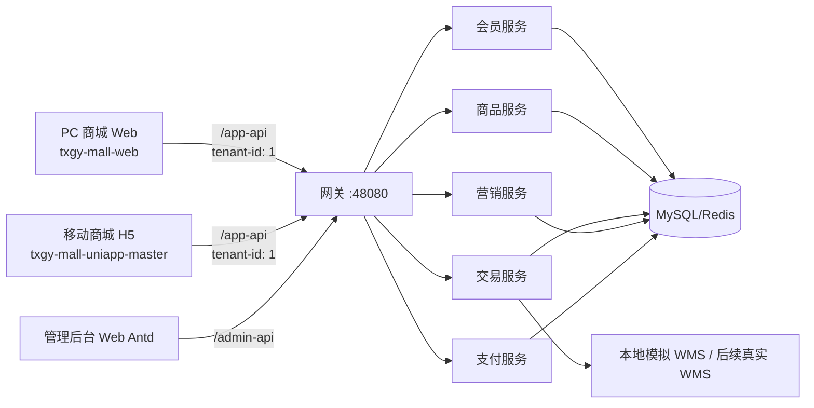

# 防腐保温购物平台 PC 端 Web 开发方案

> 文档状态：开发基线（后续开发必须以本文件为入口）<br>
> 编制日期：2026-09-10<br>
> 代码基线：`master` / `c9a3608b`<br>
> 目标项目名：`txgy-mall-web`<br>
> 当前状态：已创建 PC 项目并完成首轮主要页面；后端联调与阶段验收进行中

## 1. 文档目的

在现有商城系统中新增独立的 PC 用户端 Web 项目，界面针对桌面浏览器重新设计，主要功能与移动用户端 `txgy-mall-uniapp-master` 保持一致。

PC 端与移动端不得建立两套会员或交易数据。两端必须使用相同的商城后端、相同的租户、相同的会员身份体系以及相同的商品、购物车、地址、订单、支付、售后数据。用户使用同一手机号和密码登录后，应看到一致的业务数据。

本文件同时作为后续开发、评审、测试和交付的共同依据。开始开发前先核对本文“已确认决策”和“开发前检查”，开发过程中持续更新实施状态与变更记录。

## 2. 已确认决策

以下内容视为本项目当前确定的开发约束，除非用户明确提出变更，否则后续开发不得自行改变。

1. PC 端是面向商城普通用户的独立前端，不是管理后台，也不放入 `txgy-ui-admin-vben`。
2. 新项目目录使用仓库根目录下的 `txgy-mall-web`。
3. PC 端与移动端共同访问网关的 `/app-api`，不得为 PC 端复制一套后端业务接口。
4. 商城公共租户统一为 `tenant_id = 1`。所有未登录请求、注册请求和登录后的业务请求均按租户 `1` 处理。
5. 不再使用租户 `3000` 的页面、账号注册规则或商品数据作为 PC 端方案。
6. 注册继续使用现有 `/member/auth/register`，后端配置 `mall.registration.platform-tenant-id: 1` 负责把新会员注册到租户 `1`。
7. PC 与移动端允许各自持有登录令牌，不要求复制浏览器本地 Token；“同一账户”由后端的同一会员记录确定。
8. 购物车、收藏、浏览记录、地址、钱包、订单、评价和售后均以服务端数据为准，不能仅保存在 PC 浏览器本地。
9. 商品分类与展示方向为防腐、保温及配套材料，商品源仍使用管理后台维护的正式商品数据。
10. WMS 暂时沿用现有本地模拟/当前后端实现。PC 端只依赖商城库存接口，不直接连接 WMS；将来切换真实 WMS 时原则上不改 PC 页面。
11. 首期以完成完整购物主链路为最高优先级，高级营销能力按后续阶段逐步开放。
12. 未经用户允许不得修改商城系统之外的代码；需要改后端、网关、部署或公共组件时，先列出文件并检查与远程分支的潜在冲突。

## 3. 当前系统基线

### 3.1 现有端与职责

| 系统 | 目录/入口 | 职责 |
| --- | --- | --- |
| 移动用户端 | `txgy-mall-uniapp-master`，本地端口 `5174` | H5/移动页面、会员登录、购物完整链路 |
| PC 用户端 | 计划新增 `txgy-mall-web`，建议本地端口 `5175` | 桌面商城页面，复用移动端同一业务数据 |
| 管理后台 | `txgy-ui-admin-vben/apps/web-antd`，本地端口 `5173` | 商品、店铺、订单、售后、营销等运营管理 |
| API 网关 | `txgy-gateway`，本地映射端口 `48080` | 对外统一暴露 `/app-api` 与 `/admin-api` |
| 会员服务 | `txgy-module-member` | 注册、登录、会员资料、地址、积分等 |
| 商品服务 | `txgy-module-mall/txgy-module-product-server` | 商品、分类、店铺、评价、收藏、浏览记录、库存摘要 |
| 交易服务 | `txgy-module-mall/txgy-module-trade-server` | 购物车、结算、订单、配送、售后 |
| 营销服务 | `txgy-module-mall/txgy-module-promotion-server` | 优惠券、活动、装修、文章等 |
| 支付服务 | `txgy-module-pay/txgy-module-pay-server` | 支付订单、支付渠道、钱包 |

### 3.2 已存在的关键规则

- 移动端开发环境请求地址为 `http://localhost:48080/app-api`。
- 移动端 `.env.development` 与 `.env.production` 当前均配置 `SHOPRO_TENANT_ID=1`。
- 移动端请求拦截器统一添加 `Authorization`、`terminal` 和 `tenant-id` 请求头。
- 后端注册接口通过 `mall.registration.platform-tenant-id: 1` 在租户上下文中创建会员。
- 网关/Nginx 对未携带租户头的商城请求提供租户 `1` 的兜底，但 PC 端仍应主动发送 `tenant-id: 1`。
- 后端统一响应结构为 `{ code, data, msg }`，`code === 0` 表示业务成功，`code === 401` 进入刷新令牌或重新登录流程。

## 4. 总体架构



核心原则是“一套后端业务数据、两个用户端展示层”。PC 和移动端不直接相互同步，二者都通过后端同步。

### 4.1 同步语义

需要明确区分以下概念：

- 账号一致：同一租户 `1` 下，同一手机号对应同一会员记录。
- 数据一致：两端根据同一会员 Token 身份访问服务端记录。
- 会话独立：PC 和移动端可分别登录、分别刷新 Token；其中一端退出不应误删另一端业务数据。
- 刷新后可见：一端完成写操作后，另一端刷新相关页面或重新获得窗口焦点，应看到最新数据。
- 不要求毫秒级推送：首期不为购物车、订单建立 WebSocket 实时广播；如后续确有需求再增加事件通知。

### 4.2 保证同步的实现规则

1. Pinia 仅保存 UI 状态、Token 和短期缓存，不作为购物车、订单等业务数据的最终来源。
2. 登录成功、路由进入、窗口从后台恢复、下单/取消/收货/售后等写操作成功后，重新请求对应服务端数据。
3. 使用 `visibilitychange` 或 `window.focus` 做节流刷新，建议两次刷新至少间隔 3 秒，避免频繁请求。
4. 所有写接口成功后使相关查询缓存失效，例如加入购物车后刷新购物车数量和列表。
5. 金额、优惠、库存、运费不得以前端计算结果为最终结果，必须以结算或创建订单接口返回值为准。
6. 不在 LocalStorage 中长期保存订单列表、地址簿、钱包余额等敏感或易过期数据。

## 5. 技术方案

### 5.1 推荐技术栈

PC 端建议使用：

- Vue 3
- Vite
- TypeScript（开启严格模式）
- Vue Router
- Pinia
- Axios
- Element Plus（PC 商城基础交互组件）
- Sass
- Vitest + Vue Test Utils（单元测试）
- Playwright（核心业务端到端测试）
- pnpm（与仓库现有前端工具保持一致）

依赖的准确版本在创建项目时根据仓库 Node/pnpm 环境确定并锁定，本文不预先写死可能过期的版本号。

### 5.2 为什么新建独立项目

- 移动端基于 uni-app，页面单位、组件库、路由和交互模式面向移动设备，直接拉宽会造成维护困难。
- 管理后台包含权限菜单和后台布局，不适合作为公开商城的运行壳。
- 独立 PC 项目可以保留桌面端搜索、筛选、对比、宽屏详情和订单中心体验，同时只复用后端契约。
- 项目边界清楚，后续构建镜像时不会迫使移动端与管理后台一起重构。

### 5.3 建议目录结构

```text
txgy-mall-web/
├─ public/
├─ src/
│  ├─ api/
│  │  ├─ http.ts
│  │  ├─ member/
│  │  ├─ product/
│  │  ├─ trade/
│  │  ├─ promotion/
│  │  └─ pay/
│  ├─ assets/
│  ├─ components/
│  │  ├─ common/
│  │  ├─ goods/
│  │  ├─ cart/
│  │  └─ order/
│  ├─ composables/
│  ├─ constants/
│  ├─ layouts/
│  │  ├─ MallLayout.vue
│  │  └─ MemberLayout.vue
│  ├─ router/
│  ├─ stores/
│  │  ├─ auth.ts
│  │  ├─ user.ts
│  │  ├─ cart.ts
│  │  └─ app.ts
│  ├─ styles/
│  ├─ types/
│  ├─ utils/
│  ├─ views/
│  │  ├─ home/
│  │  ├─ category/
│  │  ├─ search/
│  │  ├─ goods/
│  │  ├─ cart/
│  │  ├─ checkout/
│  │  ├─ order/
│  │  ├─ after-sale/
│  │  ├─ member/
│  │  └─ auth/
│  ├─ App.vue
│  └─ main.ts
├─ tests/
│  ├─ unit/
│  └─ e2e/
├─ .env.development
├─ .env.production
├─ Dockerfile
├─ nginx.conf
├─ package.json
├─ tsconfig.json
└─ vite.config.ts
```

禁止从移动端直接复制整套页面或依赖 `uni.*` API。允许参照移动端的接口字段映射和业务流程，但 PC 端 API 层、组件和路由应使用标准 Web 实现。

## 6. 环境与请求规范

### 6.1 环境变量建议

```dotenv
VITE_APP_TITLE=防腐保温购物平台
VITE_APP_PORT=5175
VITE_API_BASE_URL=http://localhost:48080
VITE_API_PREFIX=/app-api
VITE_TENANT_ID=1
VITE_STATIC_BASE_URL=http://localhost:48080
```

生产环境优先使用同域反向代理：

```dotenv
VITE_API_BASE_URL=
VITE_API_PREFIX=/app-api
VITE_TENANT_ID=1
```

环境文件不得提交真实密码、短信密钥、支付密钥或生产 Token。

### 6.2 请求头

所有商城请求统一经过 `src/api/http.ts`：

| 请求头 | 规则 |
| --- | --- |
| `tenant-id` | 固定发送字符串 `1`，不提供用户可修改入口 |
| `terminal` | 使用后端支持的 H5/Web 终端值；编码前从现有终端枚举确认，不自行猜测 |
| `Authorization` | 登录后发送 `Bearer <accessToken>`；封装时避免重复添加 `Bearer` |
| `Content-Type` | JSON 请求使用 `application/json;charset=UTF-8` |
| `Accept` | `application/json` 或 `*/*` |

### 6.3 响应与异常处理

1. HTTP 成功不等于业务成功，必须检查响应 `code`。
2. `code === 0` 返回 `data`。
3. `code === 401` 时只允许一个刷新 Token 请求，其余请求进入队列；刷新成功后重放，失败则清空本端 Token 并跳转登录页。
4. `403` 显示无权限提示；`404` 显示资源不存在；`429` 做限流提示；`5xx` 显示服务异常。
5. 请求超时、网关返回空内容或非 JSON 时必须落到统一错误页/提示，不能导致白屏。
6. 登录、支付、创建订单等请求禁止无条件自动重试，防止重复写入；查询类请求最多重试一次。

### 6.4 Token 存储

首期为了与现有架构兼容，可将 `accessToken` 和 `refreshToken` 保存到 LocalStorage，并严格避免输出到日志。生产强化方案是由同域 BFF 写入 `HttpOnly + Secure + SameSite` Cookie；该方案涉及网关和部署改造，实施前需单独确认。

PC 与移动端无需共享本地 Token。它们使用同一账号各自登录后，后端根据 Token 中的 `userId + tenantId` 返回同一用户数据。

## 7. 页面与功能范围

### 7.1 路由规划

| 页面 | 建议路由 | 登录要求 | 首期 |
| --- | --- | --- | --- |
| 首页 | `/` | 否 | 是 |
| 全部分类 | `/categories` | 否 | 是 |
| 搜索结果 | `/search?q=` | 否 | 是 |
| 商品列表 | `/goods?categoryId=` | 否 | 是 |
| 商品详情 | `/goods/:id` | 否 | 是 |
| 登录 | `/login` | 否 | 是 |
| 注册 | `/register` | 否 | 是 |
| 忘记/重置密码 | `/forgot-password` | 否 | 是 |
| 购物车 | `/cart` | 是 | 是 |
| 确认订单 | `/checkout` | 是 | 是 |
| 支付收银台 | `/pay/:orderId` | 是 | 是 |
| 支付结果 | `/pay/result` | 是 | 是 |
| 个人中心 | `/member` | 是 | 是 |
| 账号资料 | `/member/profile` | 是 | 是 |
| 收货地址 | `/member/addresses` | 是 | 是 |
| 我的订单 | `/member/orders` | 是 | 是 |
| 订单详情 | `/member/orders/:id` | 是 | 是 |
| 售后列表 | `/member/after-sales` | 是 | 是 |
| 售后申请/详情 | `/member/after-sales/:id?` | 是 | 是 |
| 商品收藏 | `/member/favorites` | 是 | 是 |
| 浏览足迹 | `/member/history` | 是 | 是 |
| 商品评价 | `/goods/:id/comments` | 否 | 是 |
| 发表评价 | `/member/orders/:id/comment` | 是 | 是 |
| 优惠券中心 | `/coupons` | 部分 | 第二阶段 |
| 钱包/积分 | `/member/wallet`、`/member/points` | 是 | 第二阶段 |
| 秒杀/拼团/积分商城 | `/activities/*` | 视接口 | 后续阶段 |
| 客服 | `/support` | 视实现 | 后续阶段 |

### 7.2 首期完整业务主链路

首期完成标准不是“页面能打开”，而是以下链路可以真实写入后端并在移动端看到结果：

1. 未登录用户浏览首页、分类、搜索和商品详情。
2. 手机号注册，注册用户属于租户 `1`，注册成功自动登录。
3. 同一账号可在 PC 与移动端登录并读取相同会员资料。
4. 选择 SKU 和数量加入购物车。
5. 在 PC 修改购物车数量或删除商品，移动端刷新后结果一致；反向操作同样成立。
6. 新增/编辑/删除收货地址，两端刷新后一致。
7. 从购物车或立即购买进入结算，选择地址与配送方式。
8. 后端重新计算价格、库存、优惠和运费，PC 显示结算结果。
9. 创建订单并进入支付页；使用当前可用的支付方式完成或模拟支付。
10. 在订单中心查看、取消、支付、确认收货、删除符合状态的订单。
11. 对符合条件的订单发起售后、填写退货物流、取消售后。
12. 完成订单评价，商品详情页可看到评价结果。

### 7.3 防腐保温行业 PC 布局

PC 首页采用固定宽度内容区（建议最大宽度 1200～1440px），包含：

- 顶部服务栏：登录/注册、个人中心、我的订单、帮助入口。
- 主头部：平台标识、商品搜索、购物车入口。
- 分类导航：以现有商品分类接口为准，不在前端硬编码另一套分类主数据。
- 首屏：防腐材料、保温材料、管件及施工配套等业务入口和轮播位。
- 商品区：分类推荐、热销/新品（如后端暂无标记，则按明确的排序字段展示，不伪造业务标签）。
- 页脚：平台说明、采购流程、配送售后、联系方式（正式内容由用户后续确认）。

商品详情重点展示：商品名称、所属店铺、价格、规格属性、库存、计量单位、起订数量、配送方式、图文详情、评价。店铺名称必须使用商品接口返回或根据 `shopId` 查询的真实店铺，不能在前端默认写成“平台自营”。

## 8. API 复用清单

以下路径均以 `/app-api` 为前缀。字段定义以对应 Java Controller 的 Request/Response VO 为最终依据，移动端 `sheep/api` 可作为调用示例，但不能替代后端契约。

### 8.1 认证与会员

| 功能 | 方法与路径 |
| --- | --- |
| 手机密码登录 | `POST /member/auth/login` |
| 手机号注册 | `POST /member/auth/register` |
| 短信验证码登录 | `POST /member/auth/sms-login` |
| 发送验证码 | `POST /member/auth/send-sms-code` |
| 刷新令牌 | `POST /member/auth/refresh-token?refreshToken=` |
| 登出 | `POST /member/auth/logout` |
| 会员信息 | `GET /member/user/get` |
| 修改资料 | `PUT /member/user/update` |
| 修改手机号 | `PUT /member/user/update-mobile` |
| 修改/重置密码 | `PUT /member/user/update-password`、`PUT /member/user/reset-password` |
| 地址增删改查 | `/member/address/create|update|delete|get|list|get-default` |

### 8.2 商品

| 功能 | 方法与路径 |
| --- | --- |
| 分类列表 | `GET /product/category/list` |
| 商品分页/搜索 | `GET /product/spu/page` |
| 商品详情 | `GET /product/spu/get-detail?id=` |
| 批量商品 | `GET /product/spu/list-by-ids?ids=` |
| 店铺列表/详情 | `GET /product/shop/list`、`GET /product/shop/get?id=` |
| 商品评价 | `GET /product/comment/page` |
| 收藏创建/删除/分页 | `/product/favorite/create|delete|page` |
| 收藏状态/数量 | `/product/favorite/exits|get-count`（保留现有接口拼写） |
| 浏览记录分页/删除/清空 | `/product/browse-history/page|delete|clean` |
| WMS 库存摘要 | `GET /product/wms/sku-summary`，仅在后端已有能力时使用 |

### 8.3 购物车与交易

| 功能 | 方法与路径 |
| --- | --- |
| 加入购物车 | `POST /trade/cart/add` |
| 修改数量 | `PUT /trade/cart/update-count` |
| 修改选中 | `PUT /trade/cart/update-selected` |
| 删除购物项 | `DELETE /trade/cart/delete?ids=` |
| 购物车列表 | `GET /trade/cart/list` |
| 订单结算 | `GET /trade/order/settlement` |
| 创建订单 | `POST /trade/order/create` |
| 订单列表/详情/数量 | `/trade/order/page|get-detail|get-count` |
| 取消/删除订单 | `DELETE /trade/order/cancel|delete` |
| 确认收货 | `PUT /trade/order/receive` |
| 物流轨迹 | `GET /trade/order/get-express-track-list` |
| 订单评价 | `POST /trade/order/item/create-comment` |
| 快递公司 | `GET /trade/delivery/express/list` |
| 自提门店 | `GET /trade/delivery/pick-up-store/list|get` |

注意：现有移动端结算接口会把 `items[i].skuId/count/cartId` 编码到查询参数中。PC 实现必须先对照 `AppTradeOrderSettlementReqVO` 验证数组序列化方式，并通过真实接口测试后再封装，不能仅依赖 Axios 默认数组格式。

### 8.4 支付与售后

| 功能 | 方法与路径 |
| --- | --- |
| 支付渠道 | `GET /pay/channel/get-enable-code-list` |
| 支付订单 | `GET /pay/order/get` |
| 提交支付 | `POST /pay/order/submit` |
| 钱包信息 | `GET /pay/wallet/get` |
| 售后分页/详情 | `GET /trade/after-sale/page|get` |
| 创建售后 | `POST /trade/after-sale/create` |
| 退货物流 | `PUT /trade/after-sale/delivery` |
| 取消售后 | `DELETE /trade/after-sale/cancel` |
| 售后日志 | `GET /trade/after-sale-log/list` |

### 8.5 装修与营销

PC 首期不直接照搬移动端装修 JSON。首页可以使用独立 PC 布局，但商品、分类、价格和活动仍读取后端。若后续要求运营后台可配置 PC 首页，再扩展独立的 PC 装修终端类型，不能让 PC 强行解释移动端尺寸配置。

## 9. 核心业务设计

### 9.1 注册与登录

注册表单首期包含手机号、密码、确认密码、短信验证码（是否强制取决于当前后端 Request VO）。前端不提交 `tenantId` 作为业务字段，始终发送请求头 `tenant-id: 1`，最终租户由后端注册配置强制确定。

登录成功流程：

1. 保存访问令牌、刷新令牌和过期时间。
2. 请求 `/member/user/get` 校验身份。
3. 并行刷新购物车数量、会员资产摘要。
4. 跳回登录前目标路由，禁止固定跳首页破坏结算流程。
5. 若后端返回的会员租户与当前租户不一致，应终止会话并提示配置异常，不允许前端静默切换租户。

### 9.2 商品与店铺

- 分类树使用 `/product/category/list` 动态生成。
- 搜索参数至少覆盖关键字、分类、价格排序和分页，准确参数以商品分页 VO 为准。
- SKU 选中后显示对应价格、库存和图片。
- 加购前校验 SKU 完整、数量大于零且不超过当前可售库存。
- 页面中的店铺名称不得由 `shopId === 1` 或缺失名称推断。详情返回无店铺名称时调用店铺详情接口补齐；接口失败时显示“店铺信息加载失败”，不能显示错误店铺。

### 9.3 购物车

- 未登录点击加购时记录目标动作并引导登录，登录成功后由用户确认是否继续执行，避免重复加购。
- 登录态购物车完全走服务端接口。
- 修改数量采用防抖，但切换页面前必须等待最后一次请求完成或回滚 UI。
- 乐观更新失败时恢复服务端值并提示原因。
- 跨端场景以最后一次成功写入后端的操作为准；另一端刷新购物车时覆盖本地缓存。

### 9.4 结算与订单

订单确认页不自行拼接最终金额。进入页面先调用结算接口，地址、配送、优惠选择发生变化时重新结算。

创建订单按钮需要防重复提交：第一次点击后锁定，只有明确失败才解锁。创建成功后保存后端返回的订单号/支付订单信息并进入支付流程，不重复调用创建接口。

订单状态按钮必须根据后端状态与权限渲染，不能只按前端文案判断。

### 9.5 支付

- 支付渠道由后端接口决定，不硬编码“微信/支付宝一定可用”。
- 本地联调可使用当前已配置的模拟支付。
- 提交支付前显示订单号、金额和渠道二次确认。
- 前端返回页不能单凭 URL 参数判定支付成功，必须重新查询支付订单或业务订单状态。
- 支付密钥和回调签名全部属于后端职责，禁止进入 PC 代码。

### 9.6 售后与评价

售后申请从真实订单项进入，校验可售后数量、原因、说明和凭证。提交后刷新订单详情与售后列表。退货物流只在后端状态允许时显示。

评价入口仅对后端标记可评价的订单项开放，成功后刷新商品评价与订单状态。

## 10. 分阶段实施计划

### 阶段 0：开发前核验

目标：确定当前代码、服务和数据库基线，避免在错误分支上开发。

- 检查当前分支、远程跟踪关系、未提交改动。
- 拉取远程引用后比较目标分支，先做只读冲突检查。
- 确认 `member/product/trade/promotion/pay/gateway` 当前启动方式。
- 确认 MySQL 租户 `1` 下存在商城、店铺、分类、SPU、SKU 和库存测试数据。
- 使用同一测试账号验证移动端登录、购物车、地址和订单接口。
- 导出或查看 Swagger/OpenAPI，确认本文 API 参数未发生变化。

交付物：基线检查记录，不修改业务代码。

### 阶段 1：项目骨架与公共能力

目标：PC 项目能启动并稳定访问公开接口。

- 创建 `txgy-mall-web`，完成 TypeScript、路由、Pinia、样式、环境配置。
- 建立商城主布局、会员中心布局、404 与服务异常页。
- 完成 HTTP 客户端、租户头、Token、刷新队列、错误处理。
- 完成登录守卫和登录前路由恢复。
- 增加 lint、typecheck、unit test、build 命令。

验收：访问首页能拉取分类/商品；后端不可用时有错误状态且不白屏。

### 阶段 2：商品浏览链路

目标：未登录用户完成找商品全过程。

- 首页、分类导航、商品列表、搜索、分页与排序。
- 商品详情、SKU 选择、库存、店铺、图文详情、评价列表。
- 防腐保温平台桌面布局与基本响应式适配。

验收：管理后台上下架或修改商品后，PC 刷新能看到一致结果；移动与 PC 的商品价格、SKU、库存、店铺一致。

### 阶段 3：账号与跨端会员数据

目标：同一账号可在 PC 和移动端正常使用。

- 注册、密码登录、短信登录、退出、刷新 Token、重置密码。
- 会员资料、地址、收藏、浏览足迹。
- 页面聚焦刷新和写操作后查询失效。

验收：同一手机号在两端识别为租户 `1` 的同一会员；两端修改资料、地址、收藏后刷新一致。

### 阶段 4：购物车、结算、下单

目标：完成真实订单创建。

- 购物车增删改选、购物车角标。
- 立即购买与购物车结算。
- 地址、配送、库存和金额重新结算。
- 创建订单、防重复提交、订单列表与详情。

验收：PC 加购后移动端可见；移动端改数量后 PC 可见；PC 创建订单后两端订单列表一致。

### 阶段 5：支付、履约、售后、评价

目标：闭合交易后半程。

- 可用支付渠道、模拟/真实支付入口、结果回查。
- 取消订单、确认收货、物流轨迹。
- 售后申请、售后详情、退货物流、取消售后。
- 订单评价与商品评价展示。

验收：完整执行“注册/登录 → 商品 → 加购 → 结算 → 下单 → 支付 → 发货 → 收货 → 评价/售后”。

### 阶段 6：营销与体验增强

目标：在主链路稳定后补齐非必需能力。

- 优惠券、积分、钱包。
- 秒杀、拼团等活动（根据简化营销配置决定是否开放）。
- 客服、文章、帮助中心。
- SEO、性能、可访问性和更完整响应式布局。

### 阶段 7：容器化与交付

目标：PC 与商城后端可在 Docker 环境稳定联调。

- PC 多阶段构建镜像和 Nginx history 路由回退。
- 为 PC 设置独立端口，建议 `5175`；生产映射由部署环境确定。
- `/app-api` 反向代理到 `gateway:48080`。
- 开启静态资源缓存，`index.html` 禁止长期缓存。
- 对实际有代码变化的镜像做定向重构，不无差别重建所有模块。

重要现状：基线 `deploy/docker-compose.yml` 中 `member`、`pay`、`product`、`trade`、`promotion` 等商城服务处于注释状态。进入 Docker 联调前必须先核对实际使用的 Compose 文件/分支，得到用户许可后再修改部署配置，不能假定这些服务已启动。

## 11. 测试方案

### 11.1 静态检查与构建

每个开发阶段至少执行：

```bash
pnpm lint
pnpm typecheck
pnpm test:unit
pnpm build
```

若机器内存导致类型检查失败，必须记录为“检查未完成”，不能描述为代码通过；应优先分包或降低并发，而不是默认跳过。

### 11.2 API 冒烟

使用租户 `1` 验证：

- 未登录分类、商品列表、商品详情返回 `code=0`。
- 登录/注册返回访问令牌，随后会员信息返回同一用户。
- 购物车、地址和订单未登录时返回明确认证错误。
- Token 过期可以刷新；刷新失败会清理本端会话。
- 所有中文商品、分类和店铺名称无乱码。

### 11.3 跨端同步用例

| 编号 | PC 操作 | 移动端验证 | 预期 |
| --- | --- | --- | --- |
| SYNC-01 | 注册新手机号 | 使用相同账号登录 | 同一会员、租户均为 `1` |
| SYNC-02 | 修改昵称 | 刷新个人中心 | 昵称一致 |
| SYNC-03 | 新增地址 | 打开地址列表 | 地址一致 |
| SYNC-04 | 加入购物车 | 刷新购物车 | SKU 与数量一致 |
| SYNC-05 | 修改购物车数量 | 刷新购物车 | 数量与价格一致 |
| SYNC-06 | 收藏商品 | 刷新收藏列表 | 收藏状态一致 |
| SYNC-07 | 创建订单 | 刷新订单列表 | 订单号、金额、状态一致 |
| SYNC-08 | 取消订单 | 刷新订单详情 | 状态一致 |
| SYNC-09 | 确认收货 | 刷新订单详情 | 状态一致 |
| SYNC-10 | 申请售后 | 刷新售后列表 | 售后单一致 |

以上用例还需反向执行一次，即移动端写入、PC 验证。

### 11.4 端到端主链路

准备三个账号：新注册账号、已有订单账号、售后测试账号。E2E 不应直接依赖生产手机号或真实支付资金。

自动化优先覆盖：

1. 首页到商品详情。
2. 登录、Token 刷新与退出。
3. 加购、修改数量、选择购物项。
4. 地址维护、订单结算和创建。
5. 模拟支付结果回查。
6. 订单取消/收货。
7. 售后申请和评价。

### 11.5 浏览器与分辨率

- Chrome、Edge 当前稳定版为必测。
- Firefox 作为兼容性抽测。
- 桌面分辨率至少覆盖 1366×768、1920×1080、2560×1440。
- 页面宽度小于 1024px 时提供可用的收缩布局，但移动体验仍以现有 H5 为主。

## 12. 安全、性能与可维护性要求

### 12.1 安全

- 不信任前端传来的价格、库存、用户编号和租户编号，后端必须再次校验。
- 商品富文本详情用白名单方式防 XSS。
- 跳转地址只允许站内路由或白名单域名，防止开放重定向。
- 日志和错误上报中屏蔽密码、验证码、Token、手机号等敏感信息。
- 支付完成必须以后端状态为准。
- 管理后台接口 `/admin-api` 不得被 PC 商城调用。

### 12.2 性能

- 首页、分类和商品详情按路由拆包。
- 图片懒加载并预留尺寸，减少页面抖动。
- 搜索输入防抖，列表请求支持取消过期请求。
- 商品/分类可短缓存；购物车、库存、价格、订单不做长缓存。
- 生产构建分析包体，第三方组件按需引入。

### 12.3 可维护性

- 所有后端调用集中在 `src/api`，页面不得散落完整 URL。
- 后端响应类型集中定义；避免使用无边界的 `any`。
- 金额统一按后端最小货币单位处理，显示层再格式化，禁止浮点金额参与结算。
- 枚举值与后端保持一致，显示文案通过映射层转换。
- PC 与移动端发生字段差异时优先修正公共接口契约，禁止两端各自猜字段。

## 13. 与现有代码的边界

### 13.1 默认允许修改的范围

开发 PC 端时，默认仅修改：

```text
txgy-mall-web/**
docs/商城PC端Web开发方案.md
```

### 13.2 需要提前确认的范围

若必须修改以下内容，先向用户说明原因、具体文件、影响服务及推送冲突风险，得到确认后再改：

- `txgy-mall-uniapp-master/**`
- `txgy-module-mall/**`
- `txgy-module-member/**`
- `txgy-module-pay/**`
- `txgy-gateway/**`
- `txgy-server/**`
- `deploy/**`
- 数据库 SQL

商城之外的模块（例如 CRM、MES、HRM、Training 等）不在本项目范围内，不得修改。

## 14. Git 与提交规则

1. 开发前记录当前分支、HEAD、上游分支和工作区状态。
2. 不覆盖用户已有的未提交改动。
3. 每阶段提交前执行 `git diff --check`、类型检查、构建和对应测试。
4. 提交只包含该阶段 PC 商城及经确认的商城后端改动。
5. 推送前先 `git fetch`，使用 `git merge-tree`、临时分支合并或等价只读方式检查远程目标分支冲突。
6. 未得到用户明确许可不推送、不创建远程合并请求、不合并主分支。
7. 推荐提交信息：

```text
feat(mall-web): 初始化PC商城项目
feat(mall-web): 完成商品浏览与搜索
feat(mall-web): 完成会员与跨端数据同步
feat(mall-web): 完成购物车与订单主链路
feat(mall-web): 完成支付售后与评价
```

## 15. 风险与应对

| 风险 | 影响 | 应对 |
| --- | --- | --- |
| Compose 中商城服务未启用 | Docker 中接口不可用 | 开发前核对实际 Compose，获准后只启用所需服务 |
| 短信通道未真实配置 | 注册/短信登录超时 | 本地使用可审计的测试验证码方案，生产前接真实通道 |
| 支付通道仅模拟 | 无法验证真实支付 | 先完成模拟支付闭环，真实渠道单独验收 |
| WMS 尚未正式对接 | 库存可能为本地模拟 | PC 只读商城库存接口，保持 WMS 细节在后端 |
| 移动端存在兼容/容错字段 | PC 错误复刻临时逻辑 | 以 Java VO 和真实接口响应为准 |
| 多端缓存造成显示延迟 | 用户误认为数据不一致 | 写后刷新、聚焦刷新、手动刷新入口 |
| 店铺字段缺失 | 错误显示平台自营 | 根据 `shopId` 查询真实店铺，失败时不猜值 |
| 前端类型检查占用内存 | 检查中断 | 严格 TS、分包检查、串行任务，并记录未完成项 |

## 16. 交付与验收标准

PC 端可交付需同时满足：

- 项目可以用文档中的命令安装、启动、测试和构建。
- 页面无白屏，接口异常有可理解的提示和重试入口。
- 核心页面适合桌面端，不是移动 H5 的简单放大。
- 租户固定为 `1`，新注册用户属于租户 `1`。
- 同一账号在 PC 和移动端的会员、地址、购物车、收藏、订单、支付结果、售后和评价数据一致。
- 商品详情显示真实店铺、SKU、价格和库存。
- 主业务链路在本地服务和 Docker 环境各完成一次真实联调。
- lint、typecheck、单元测试、E2E 核心用例和生产构建通过。
- 无商城范围外代码改动；所有例外修改均有用户确认记录。
- 提交记录按阶段拆分，推送前完成冲突检查。

## 17. 后续开发启动清单

后续使用本文件开始开发时，按以下顺序执行并回填结果：

- [ ] 阅读“已确认决策”和“与现有代码的边界”。
- [ ] 执行 `git status -sb`，记录分支与未提交改动。
- [ ] 执行 `git log -1 --oneline`，更新本文代码基线。
- [ ] 核对远程目标分支，开发前做冲突风险检查。
- [ ] 确认移动端 `SHOPRO_TENANT_ID=1`。
- [ ] 确认后端 `mall.registration.platform-tenant-id=1`。
- [ ] 确认网关及 member/product/trade/promotion/pay 服务可用。
- [ ] 用测试账号完成一次移动端基线测试并记录账号数据状态。
- [ ] 确认阶段目标后再开始修改代码。
- [ ] 每完成一个阶段更新本文实施状态、测试结果和变更记录。

## 18. 实施记录模板

每个阶段完成后在本节追加，不删除历史记录：

```markdown
### YYYY-MM-DD 阶段 N：名称

- 分支与基线：
- 实际修改范围：
- 已完成功能：
- 接口/数据库变化：无 / 具体内容
- 验证命令与结果：
- PC 与移动端同步验证：
- 未完成事项：
- 需后续对接事项：
- 提交编号：
- 推送冲突检查：未执行 / 结果
```

## 19. 变更记录

| 日期 | 版本 | 内容 |
| --- | --- | --- |
| 2026-09-10 | 0.1 | 建立 PC 商城总体架构、功能范围、接口复用、跨端同步、实施与验收方案 |
| 2026-09-10 | 0.2 | 创建 `txgy-mall-web`，记录首轮页面实现、类型检查和待联调项 |
| 2026-09-10 | 0.3 | 完成 Docker 公共浏览链路联调、评论参数适配及 PC 商城镜像验证 |
| 2026-09-10 | 0.4 | 补齐 PC 售后退货操作、全链路售后验收与全国快递模板配置 |

### 2026-09-10 阶段 1～5：首轮 PC 页面与接口层

- 分支与基线：`master` / `c9a3608b`
- 实际修改范围：`txgy-mall-web/**`、本开发方案
- 已完成功能：PC 主布局、首页、分类、搜索与商品列表、商品详情与评价、登录注册与忘记密码、购物车、结算、会员中心、地址、订单列表与详情、订单评价、支付收银台与支付结果、收藏、足迹、售后列表与售后申请
- 公共能力：租户 `1`、终端 `20`、Token 刷新队列、登录路由守卫、页面聚焦节流刷新、统一异常提示、超长 Long 字符串标识兼容、商品富文本白名单清洗
- 接口/数据库变化：无；全部复用现有 `/app-api`
- 验证命令与结果：`pnpm test:unit`（3 项）通过；`pnpm typecheck` 通过；`pnpm build` 通过；1440×1000 首页视觉检查通过
- PC 与移动端同步验证：代码路径已统一到服务端数据源；真实双端操作尚待商城后端启动后执行
- 未完成事项：Docker Desktop 当前处于 Paused，后端无法从 `localhost:48080` 访问，Vite 代理返回 502；完整 API、支付及跨端 E2E 尚未验收；Element Plus 主包仍有体积优化空间
- 需后续对接事项：真实短信通道、真实支付通道、真实 WMS 按原计划保留
- 提交编号：未提交
- 推送冲突检查：未执行

### 2026-09-10 Docker 联调：发货、评价、售后与全国运费

- 实际修改范围：`txgy-mall-web/**`、本开发方案；后端源码无修改
- PC 功能补充：售后列表增加状态中文映射、正确显示 `applyReason`、取消售后、选择快递公司和填写退货物流单号
- 完整订单验收：测试订单 `320` 经 mock 支付、后台申通快递发货、会员确认收货和商品评价，订单状态依次为 10→20→30，评价 `940033` 可由商品评价接口查询
- 完整售后验收：售后单 `38` 经会员申请、后台同意、会员填写退货物流、后台收货与退款，状态依次为 10→20→30→40→50；订单最终为退款状态 40
- 支付回调说明：本地 pay 服务生成的退款通知地址为容器内 `127.0.0.1:48080`，mock 退款成功后通过既有 `update-refunded` 通知接口完成状态回写；真实支付回调地址继续作为后续部署配置预留
- 运费配置：通过正式后台接口创建租户 1 的“商城全国快递模板” `14`，按件计费，覆盖系统区域树 3209 个末级地区；为 29 个支持快递且模板为空的租户 1 商品分配该模板，剩余缺失数为 0
- 全国运费验证：使用北京区县地址对原先无法结算的商品 `910027` 验证成功，运费 1000 分；临时验证地址已删除
- 验证结果：`pnpm typecheck`、3 项单元测试、`pnpm build`、`docker build -t txgy-mall-web:local .` 全部通过；`txgy-mall-web-integration` 在 `15175:80` 运行且健康
- 外部对接预留：真实短信、真实支付、真实 WMS；当前本地短信、mock 支付、本地库存可完成业务验证
- 数据影响：仅本地 Docker 租户 1 测试数据；新增模板 14、测试订单/评价/售后记录及联调账号，无其他租户数据变更
- 提交编号：未提交
- 推送冲突检查：远程 fetch 因 Gitee TLS 握手失败未能刷新；按本地现有 `origin/master` 比较无冲突标记

### 2026-09-10 Docker 联调：公共浏览链路与镜像

- 分支与基线：`master` / `c9a3608b`
- 实际修改范围：`txgy-mall-web/**`、本开发方案
- 服务状态：MySQL、Redis、Nacos、Gateway、System、Infra、Member、Pay、Product、Trade、Promotion 均已启动并通过健康检查
- 已验证链路：PC 首页、分类（14 项）、商品分页（29 项）、商品详情、真实店铺查询、商品评价、前端深层路由刷新、未登录接口拦截、短信验证码、注册、登录、会员资料、地址、收藏、足迹、购物车、结算、订单创建/详情/取消、支付单、支付渠道、模拟支付、订单列表和售后列表
- 真实数据样例：商品 `910029`“无气喷涂机”关联店铺 `1`“测试1111”，评价分页可正常返回
- 本轮适配：商品评价分页按后端 `AppCommentPageReqVO` 补充必传参数 `type=0`；取消收藏改为按后端约定发送 DELETE 请求体
- 登录核对：手机号 `13653530831` 的账号属于租户 `1`，状态正常且未删除，但现有测试密码与密码哈希不匹配；另通过正式短信、注册和登录接口创建本地专用联调用户 `300`，确认注册用户归属租户 `1`
- 写操作验证：专用联调用户已成功写入收藏、浏览足迹、购物车和测试收件地址；无运费模板的商品会被正确拦截；改用已配置模板 13 的商品 `910004` 后结算成功。测试订单 `319` 创建、查询并取消成功；测试订单 `320` 通过 `mock` 渠道支付成功，订单进入状态 10（待发货）
- 后端镜像：重建 `deploy-member`（23 个 Maven Reactor 模块全部 SUCCESS），按原环境与网络替换旧容器并通过健康检查；已验证新容器支持匿名注册，旧容器已删除
- PC 镜像验证：`txgy-mall-web:local` 构建成功；联调容器 `txgy-mall-web-integration` 在 `15175:80` 运行且健康，根路径和深层路由返回 HTTP 200，容器内 `/app-api` 代理可访问网关
- 验证命令与结果：`pnpm typecheck` 通过；`pnpm test:unit`（3 项）通过；`docker build -t txgy-mall-web:local .` 通过
- 接口/数据库变化：无；数据库只读核对，未修改账号数据
- 需后续对接事项：后台为其余商品补齐运费模板；对测试订单 `320` 执行后台发货后继续收货、评价和售后闭环；再使用同一账号完成 PC/移动端同步验收；真实短信、真实支付、真实 WMS 继续保留
- 提交编号：未提交
- 推送冲突检查：未执行
