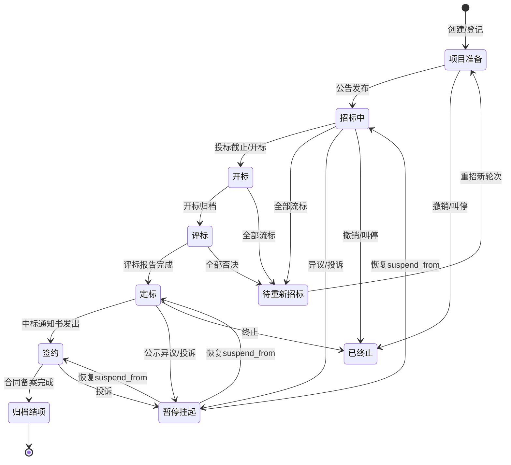
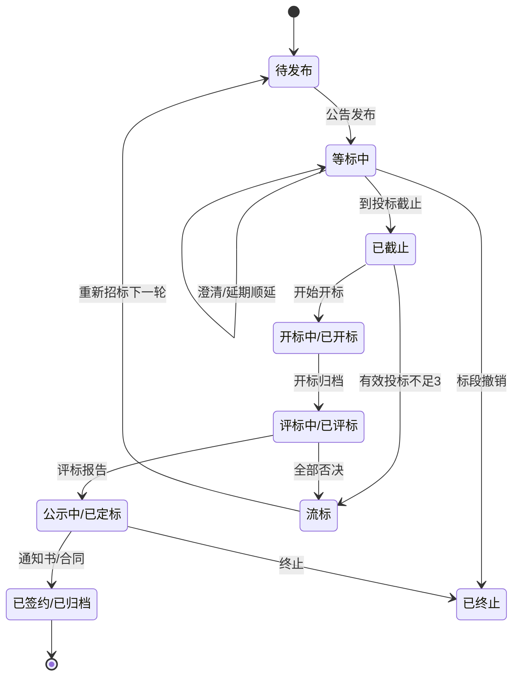
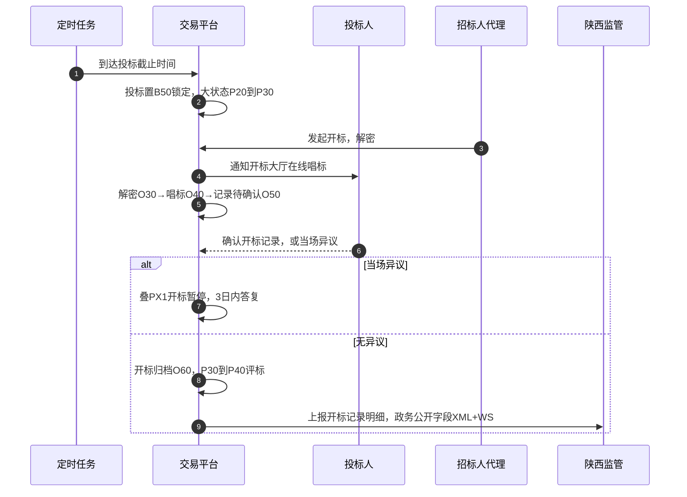
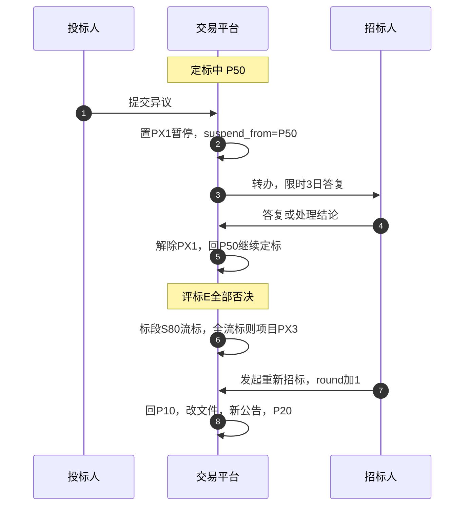

# 招投标状态管理调研报告

> 用途：供「招标项目管理模块」「投标文件管理模块」的状态设计评审。
> 架构取向：以「大状态（项目级生命周期）+ 小状态（环节级/标段级）」双层状态机建模，正向与非正向流程全覆盖，状态变更点与法定时限、数据上报点对齐。
> 依据：《电子招标投标办法》（发改委等八部委令第20号）及《电子招标投标系统技术规范》、《招标投标法》及《实施条例》、《陕西省公共资源交易电子监管系统数据规范（V2.0）》（陕交易信息〔2024〕11号）。角色视图区分招标人侧与投标人侧。

---

## 一、调研范围与建模约定

- 业务闭环：项目建档 → 招标 → 投标 → 开标 → 评标 → 定标（候选人公示/中标通知书）→ 合同 → 履约备案归档。
- 两个核心实体模块：
  - 招标项目管理：承载"项目—招标项目—标段（包）"，是**大状态的宿主**。
  - 投标文件管理：承载"投标递交—保证金—撤回—开标唱标"，是投标人侧**小状态**的主要载体，挂在标段下。
- 状态分层：
  - 大状态 `stage`：一个招标项目当前所处的生命周期阶段，项目级唯一、串行推进。
  - 小状态 `biz_status`：标段/某环节实例（公告、招标文件、某投标人投标、开标记录、评标、公示、合同）的内部状态。标段级小状态相互独立。
- 角色视图：内部状态只有一套，招标人侧/投标人侧是**同一状态的两种展示名 + 可见子集**（投标人看不到评标内部、他人报价、挂起原因等）。
- 编码约定：大状态 `P`+两位序号，小状态用环节前缀 `D`(登记)/`S`(标段)/`N`(公告)/`F`(文件)/`B`(投标)/`O`(开标)/`E`(评标)/`W`(定标公示)/`C`(合同)。

---

## 二、双层状态模型

### 2.1 大状态（项目级，7 个正向 + 3 个横切）

正向阶段串行推进，代表"整个项目走到的最远里程碑"；横切态是叠加在当前阶段上的挂起/终止标记，不改变阶段本身。

| 编码 | 大状态 | 含义 | 进入里程碑事件 | 招标人侧展示 | 投标人侧展示 |
|---|---|---|---|---|---|
| P10 | 项目准备 | 立项建档、划分标段、定招标方式，尚未对外 | 项目创建/登记通过 | 待完善/待审核 | 不可见（未挂网） |
| P20 | 招标中 | 公告/招标文件已发，处于等标期，含资格预审 | 首个公告发布 | 招标中/等标 | 可投标 |
| P30 | 开标 | 到达投标截止，进入解密、唱标 | 到达投标截止时间 或 手动开始开标 | 开标中 | 开标中 |
| P40 | 评标 | 开标结束，评委会在评审 | 开标完成归档 | 评标中 | 评标中（结果未出） |
| P50 | 定标 | 候选人公示→异议→定标→中标通知书 | 评标报告完成 | 定标中 | 待结果/公示中 |
| P60 | 签约 | 中标通知书已发，订立合同 | 中标通知书发出 | 待签约 | 中标待签约 / 未中标退保证金 |
| P70 | 归档结项 | 合同签订、备案、保证金退还、结项 | 合同备案完成 | 已归档 | 已结项 |
| PX1 | 暂停（挂起） | 异议/投诉处理，暂停推进（横切） | 收到有效异议/投诉受理 | 暂停中（原因受限可见） | 暂停中 |
| PX2 | 已终止 | 废标/流标终止、撤销项目、行政叫停（终态） | 终止决定/撤销 | 已终止 | 已终止 |
| PX3 | 待重新招标 | 全部/该标段流标后回炉（横切→重开轮次） | 触发重新招标 | 重新招标中 | 视新公告回到"可投标" |

大状态聚合规则（多标段）：项目 `stage` 取"所有标段的最小已达阶段"作为整体进度下限；只要还有标段停在 P20，项目不进入 P30。标段级进度单独由标段小状态承载，互不阻塞——某个标段先到开标，另一标段仍可留在等标期。单标段项目两者近似同步。

### 2.2 小状态（环节级 / 标段级）

按环节分组，每个环节的实例各有小生命周期。标段是承载投标、开标、评标、定标小状态的主键。

环节—登记（项目/招标项目实体）
| 编码 | 小状态 | 含义 |
|---|---|---|
| D10 | 草稿 | 建档中未提交 |
| D20 | 待审核 | 已提交待内部/进场审核 |
| D30 | 已登记 | 审核通过、生成统一交易标识码 |
| D90 | 退回修改 | 审核不通过退回（保留版本） |

环节—标段
| 编码 | 小状态 | 含义 |
|---|---|---|
| S10 | 待发布 | 标段已建、公告未发 |
| S20 | 等标中 | 公告已发、未到投标截止 |
| S30 | 已截止 | 到投标截止、未开标 |
| S40 | 开标中 / 已开标 | 解密唱标 / 唱标完成 |
| S50 | 评标中 / 已评标 | 评审 / 出评标报告 |
| S60 | 公示中 / 已定标 | 候选人公示 / 发中标通知书 |
| S70 | 已签约 / 已归档 | 合同签订 / 归档 |
| S80 | 流标 | 有效投标不足3家或全部被否（标段终态，可 fork 重招） |
| S90 | 已终止 | 标段撤销/叫停（标段终态） |

环节—公告（招标/资审/变更公告实例）
| 编码 | 小状态 | 含义 |
|---|---|---|
| N10 | 草稿 | 编制中 |
| N20 | 待审核 | 提交待审 |
| N30 | 已发布 | 对外可见（触发投标人通知+上报公共服务平台） |
| N40 | 已撤回 | 发布前撤回→回草稿；发布后撤回→变更公告+顺延 |
| N50 | 已变更/已澄清 | 发布后更正，生成变更公告，联动时间线 |
| N90 | 审核退回 | 未通过退回编辑 |

环节—招标文件 / 澄清
| 编码 | 小状态 | 含义 |
|---|---|---|
| F20 | 待审核 | 文件编制待审 |
| F30 | 已发布 | 随公告可下载 |
| F40 | 澄清/修改中 | 发出澄清，须保证澄清在投标截止15日前 |
| F50 | 已终止 | 文件废止（配合流标/终止） |

环节—投标（投标人在某标段的投标实例）
| 编码 | 小状态 | 含义 |
|---|---|---|
| B10 | 已报名/待缴保证金 | 下载文件、递交前 |
| B20 | 已递交 | 加密上传、签递交回执 |
| B30 | 已撤回 | 投标截止前撤回、版本留存 |
| B40 | 已替换/已补遗 | 截止前重新递交，取最新有效版 |
| B50 | 已锁定 | 到截止时间，开标前任何人不可见 |
| B60 | 已否决 | 评标/符合性审查否决（废标项） |
| B70 | 已唱标 | 开标解密唱标完成，报价公开 |
| B80 | 中标 / 未中标 | 定标结果落到该投标 |

环节—开标 / 评标 / 定标公示 / 合同（实例级，简化列关键态）
| 编码 | 小状态 | 含义 |
|---|---|---|
| O20 未开始 / O30 解密中 / O40 唱标中 / O50 待确认 / O60 已开标归档 / O90 开标暂停(异议/解密失败) |
| E20 组建委员会 / E30 评审中 / E40 待投标人澄清(不影响公平) / E50 报告待签 / E60 评标完成 / E90 全部否决→转流标 |
| W20 待公示 / W30 公示中(≥3日) / W40 公示有异议→挂起 / W50 公示期满无异议 / W60 已定标 / W70 通知书已发 |
| C20 待签订 / C30 已签订(中标通知书30日内) / C40 已备案(定标15日内) / C50 履约中 / C60 已交付结项 |

### 2.3 归属与独立变更

- 归属：一个项目(P*)含 1..n 标段；一个标段在同一时刻有唯一"当前小状态"，公告/文件/投标/开标/评标/公示/合同是挂在项目或标段下的环节实例，各自有小状态。大状态是这些环节推进到某里程碑后的聚合视图，不是独立第三份事实。
- 独立变更条件：
  - 环节实例小状态可在**不改变大状态**时自行变动，例：澄清(文件 F30→F40)在等标期内发生，大状态仍 P20；某投标人 B20→B30 撤回，标段 S20 不变、大状态不变。
  - 大状态变更由"阶段边界事件"触发：投标截止(P20→P30)、开标归档(P30→P40)、评标报告(P40→P50)、通知书发出(P50→P60)、备案(P60→P70)。多标段下取最小阶段规则，只有边界事件满足聚合条件才跳。
  - 横切态(PX1/PX2/PX3)独立于阶段：异议挂起只叠 PX1，记录 `suspend_from=当前大状态`，恢复后回原阶段；流标在标段级置 S80，若致全项目无可继续标段，项目级叠 PX3。

---

## 三、角色双视图映射

同一大状态在两侧展示不同，且投标人侧是"自己标段投标相关 + 已公开信息"的子集。

| 大状态 | 招标人侧 | 投标人侧（本人视角） | 投标人不可见 |
|---|---|---|---|
| P10 准备 | 待完善/待审核/已登记 | —（未挂网不可见） | 全部 |
| P20 招标中 | 招标中/等标中 | 可投标 / 已递交 / 已撤回(截止前) | 他人报名数(部分地区截止前不公开)、评委 |
| P30 开标 | 开标中/已开标 | 开标中 / 唱标可见本人及公开报价 | 未解密前任何人报价 |
| P40 评标 | 评标中 | 评标中(结果未出) | 评委名单、评审打分、评标报告 |
| P50 定标 | 定标中/公示中/已定标/待发通知书 | 候选人公示中 / 已中标 / 已落选(待退保证金) | 内部定标决策链、他人得分 |
| P60 签约 | 待签约/已签约 | 中标待签约(附合同模板) / 未中标(退保证金倒计时) | 他人合同 |
| P70 归档 | 已备案/已结项 | 已结项(未中标者保证金已退) | 备案卷宗 |
| PX1 暂停 | 暂停中+受限原因(异议/投诉) | 暂停中 | 投诉人身份、处理意见 |
| PX2/PX3 | 已终止 / 重新招标中 | 已终止 / 新公告→回到可投标 | 内部终止决策依据 |

---

## 四、状态转移矩阵

### 4.1 正向主干

| 当前 | 目标 | 触发动作 | 前置校验 | 变更后自动行为 |
|---|---|---|---|---|
| P10 D20 待审核 | P10 D30 已登记 | 进场审核通过 | 必填齐、目录判定完成、标段已划 | 生成统一交易标识码；推监管备案(政务公开字段) |
| P10 D10 草稿 | P10 D20 待审核 | 招标人/代理提交 | 项目/标段信息完整 | 通知审核人 |
| P20 S20 等标中(公告 N30) | P20 | 公告发布 | 招标文件"已审核"；等标期≥20日(自文件发出至投标截止)；澄清在截止15日前 | 公告置 N30；推送已下载投标人+公共服务平台同步(社会公开字段)；开通知订阅推送 |
| P20 | P30 开标 | 到投标截止(定时) 或 手动开标 | 到截止时间；有效投标≥3 家 | 投标文件 B20→B50 锁定；开解密/唱标 O20→O30 |
| P30 | P40 评标 | 开标记录归档(O60) | 唱标完成、投标人对开标记录确认或异议已处 | 生成评标任务 E20；抽专家组建委员会(评委名单保密) |
| P40 | P50 定标 | 评标报告完成(E60) | 报告经评委电子签名 | 进入候选人公示 W20；3日内启动公示 |
| P50 W30 公示中 | P50 W50 公示期满 | 公示满3日且无异议 | 公示期≥3日 | 允许定标 |
| P50 W60 已定标 | P60 签约 | 发中标/未中标通知书(W70) | 定标决定完成 | 中标人置 B80(中标)、落选 B80(未中标)；通知全体投标人；启动"30日内签合同""未中标5日内退保证金"倒计时；社会公开字段同步公共服务平台 |
| P60 C20→C30 | P70 归档 | 合同签订→备案(C40) | 合同主体金额与中标一致；15日内提交招投标情况书面报告 | 备案归档；履约保证金核验(≤合同10%)；结项 |

### 4.2 非正向流程（必须覆盖）

| 场景 | 当前 | 目标 | 触发 | 前置/约束 | 自动行为 |
|---|---|---|---|---|---|
| 发布前撤回 | 公告 N20 待审核 | N10 草稿 | 编制人撤回 | 未对外发布 | 无外部影响，留版本 |
| 发布后撤回/撤销 | 公告 N30 已发布 | N40 已撤回 | 招标人撤回/监督撤销 | 未过投标截止；已过则只能走终止/流标，不得撤发布 | 出"变更公告"顺延时间线；通知已下载/已报名投标人；重算等标期≥20日 |
| 审核退回 | D20/N20/F20 待审核 | D90/N90 退回修改 | 审核不通过 | 附退回意见 | 回编辑态，保留版本链，改后重提回"待审核" |
| 资审不通过(资格预审) | 申请 B(资审) 待审 | 不通过→不得进投标 | 资审结果作出 | 按资审办法 | 通知申请人；通过者进入可投标 |
| 投标截止延期 | P20 等标中 | P20(时间线顺延) | 招标人改期 | 顺延须重发变更公告，保障等标期；不跳阶段 | deadline 更新；重算截止；通知投标人；大状态不变 |
| 开标延期 | P30 边界/开标前 | P30/P20 视情况 | 未到齐/系统/异议 | 未开则回等标，已开不可延 | 记录延期事件，通知，重置解密计划 |
| 流标(投标不足) | 标段 S30 已截止 | S80 流标 | 有效投标<3 | 定标前判定 | 标段终止该轮；若全部标段流标→项目叠 PX3 待重新招标 |
| 废标(全部否决) | P40 评标 E | S80 流标 / 项目 PX3 | 评委否决所有投标 | 依《招标投标法》第42条 | 出否决说明；发不再中标通知；进入重招或终止 |
| 重新招标 | 项目 PX3 | P10/P20 新轮次 | 招标人发起 | 调整招标文件后 | round+1，历史轮次归档保留；重新挂网回到可投标 |
| 终止/撤销项目 | 任意 P* | PX2 已终止 | 招标人撤销/行政叫停 | 记录依据 | 全流程停；退保证金；已公示的作终止公告；上报监管 |
| 异议挂起 | P50/P60 推进中 | PX1 暂停(suspend_from) | 收到有效异议 | 3日内答复 | 冻结定标/签约推进；投标人侧展示"暂停中" |
| 投诉处理挂起 | 任意推进中 | PX1 暂停 | 行政监督受理投诉 | 监督责令暂停 | 冻结并等待处理决定；恢复回 suspend_from 大状态 |
| 挂起恢复 | PX1 | suspend_from 原大状态 | 异议/投诉处理完毕 | 有处理结论 | 解冻，继续原阶段；留痕全过程 |

守卫不变式（跨矩阵通用）：①已对外发布且过投标截止，不得撤回只能终止/流标；②大状态不可逆跳（只能相邻前进或经 PX*），回退只走明确的退回/撤回/重招标;③PX1 期间除"答复/处理"外禁一切推进写;④每次转移写 `from,to,operator,reason,event_id,time` 到流转日志，标段级转移带 `round`。

---

## 五、状态转移图（Mermaid）

### 5.1 大状态机

### 5.2 标段级小状态机

### 5.3 正常开评标时序（关键场景）

### 5.4 异议挂起→恢复 & 流标重招 时序

---

## 六、国内成熟平台对比（公开可证部分）

新点电子交易平台、广联达、国泰新点等商业平台的**内部状态枚举不公开**，此处只对比可观察到的流程口径与设计取向，不臆造其状态表。

| 维度 | 法定共同基线（20号令/技术规范） | 平台通行做法 | 本方案取向 |
|---|---|---|---|
| 环节链 | 登记→招标→投标→开标→评标→定标→合同→归档 | 各平台节点命名基本照搬法定环节（项目登记/进场、招标公告、投标文件递交、开标、评标、中标公示、合同、归档） | 一致；大状态直接映射法定里程碑 |
| 粒度 | 未规定双层 | 多数以"标段/流程实例"的当前节点为主，状态与节点耦合，少见显式"项目级+环节级"双层 | 显式双层 + 多标段聚合规则 |
| 角色视图 | 三平台(交易/公共/监督)分离 | 招标人端/投标端/监督端门户分别展示同一流程不同子集 | 一致；单套内部态 + 展示名映射 + 可见子集 |
| 挂起/暂停 | 异议3日答复、投诉可暂停 | 通用做法是"暂停/待处理"节点或标记，恢复后回原节点 | 独立横切态 PX1 + suspend_from 精确回退 |
| 流标/重招 | 投标<3或全否→重新招标 | 标段作废、按新流程重发，历史轮次留痕 | 标段 S80 + 项目 PX3 + round 版本化 |
| 时限驱动 | 20日等标、15日澄清、公示3日、30日签约、5日退保证金、15日备案 | 多以定时任务/提醒实现 | 把时限写成转移前置校验 + 定时事件，可审计 |
| 上报口 | 与行政监督/公共服务平台交换 | 陕西按省规范 XML+WebServices+回执 | 状态跃迁即挂"数据上报点"，复用镜像表与 PublicLevelFilter |

结论：合规平台在**环节链**上高度趋同（因都锚定同一部法律），真正差异在"是否把大/小状态分离建模、挂起与重招是否显式、时限是校验还是仅提醒、上报是否绑在状态跃迁上"。本方案在这四点都做成显式、可审计的机制。

---

## 七、落地建议

- 存储：`bidding_project.stage_code`(大) + `status_version`(乐观锁) + `stage_time`；`bidding_bid_section.biz_status_code` + `round`；环节实例（公告/文件/投标/开标记录/评标/公示/合同）各自 `status_code`。加 `suspend_from_stage`、`terminate_reason`。
- 引擎：用**表驱动转移配置**（transitions 表：from,to,action,guard,side_effect）而非重量框架；如要引入，选 Cola-StateMachine（轻、声明式、支持守卫与动作）；Spring StateMachine 对这种"多实体并行小状态"偏重，不建议。
- 守卫前置：把"仅已审核可发布、等标≥20日、澄清≤截止15日、公示≥3日、签约≤30日"等做成转移守卫函数，不满足即拒绝并回原因。
- 副作用事件化：跃迁成功→发领域事件（outbox）→Handler 做：消息通知、上报省监管(XML/WS，走镜像表 `bidding_std_*` 与 `PublicLevelFilter`)、公共服务平台同步(社会公开字段)、倒计时任务(保证金退还/备案)。副作用与状态写分离，失败可重试不影响状态一致性。
- 审计：所有跃迁进 `bidding_status_transition_log`（from/to/operator/reason/event_id/time/round），满足可追溯与等保密评。
- 与现有资产映射：大状态跃迁点=对应数据集上报点（P20公告→TenderNoticeVO 表13；P30→BidOpenRecord 表16/17；P50→WinResultPublicity 表22；P60→ContractPublicity 表23），复用模块化设计里各模块 VO 与镜像表命名，避免另立一套。

---

## 八、状态编码汇总（可直接建枚举/字典）

大状态：P10/P20/P30/P40/P50/P60/P70/PX1/PX2/PX3。
小状态：D10/D20/D30/D90；S10/S20/S30/S40/S50/S60/S70/S80/S90；N10/N20/N30/N40/N50/N90；F20/F30/F40/F50；B10/B20/B30/B40/B50/B60/B70/B80；O20/O30/O40/O50/O60/O90；E20/E30/E40/E50/E60/E90；W20/W30/W40/W50/W60/W70；C20/C30/C40/C50/C60。

（转移矩阵的机读表见附件 `招投标状态转移矩阵.xlsx`。）
