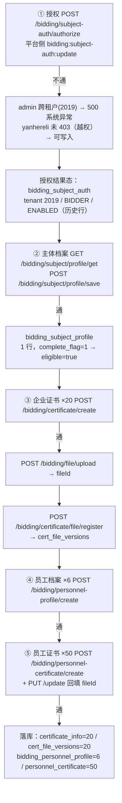

# 电子证照业务全流程 E2E 报告（延河热力 · 授权 → 主体档案 → 企业证书 → 员工证书）

- **生成时间**：2026-09-22（环境当日）
- **被测租户／账号**：tenant-id **2019** / **延河热力集团有限公司** / 用户名 **yanhereli**（登录 `POST http://127.0.0.1:48080/admin-api/system/auth/login`）
- **平台账号**：admin / tenant-id **1**（仅用于平台侧授权对照）
- **直连后端**：`http://127.0.0.1:48110`，上下文前缀必须 `/admin-api`，令牌走 `?token=`
- **判定口径**：只看 `body.code`（HTTP 恒 200）；0=成功、401=未登录、403=无权限、404=地址不存在、500=系统异常
- **脚本**：`txgy-module-bidding/sql/tools/e2e-cert-flow-yanhereli.js`（`--clean` / `--seed` / 默认全跑）
- **原始逐调用记录**：`.tmp/e2e-yh/result.json`（240 条接口记录 + 70 个文件对象）
- **造数幂等键**：备注前缀 `[E2E-YH]`、企业证书号 `E2E-YH-CERT-01..20`、员工工号 `E2E-YH-P-01..06`、员工证书号 `E2E-YH-PC-001..050`

---

## 0. 结论速览

| # | 环节 | 结论 | 关键证据 |
|---|---|---|---|
| 1 | 授权（平台侧 `bidding:subject-auth:update`） | ⚠️ **不通（平台跨租户授权 500）／且企业账号越权可授权** | admin 跨租户 authorize → `500 系统异常`；yanhereli authorize 未被 403，反而写入成功（探针 D，已立即清理）；租户 2019 的 BIDDER 授权为 2026-09-09 既有历史行 |
| 2 | 主体档案（企业自维护） | ✅ **通** | `profile/save`=0、`profile/get`=0、`profile/eligibility`=0 且 `eligible=true`；落库 `bidding_subject_profile` |
| 3 | 企业证书 ×20（建档 + 真上传 + 文件版本登记） | ✅ **通** | create 20/20、upload 20/20、file/register 20/20、change-status 7/7，全部 `code=0` |
| 4 | 员工证书 ×50（含 6 名员工档案） | ✅ **通** | personnel-profile/create 6/6、personnel-certificate/create 50/50、update 50/50（回填 fileId）、change-status 5/5 |
| 5 | 文件上传 / 版本登记 | ✅ **通（真文件、真落库）** | 71 次 upload 全部 `code=0`；下载魔数复核 PDF=`255044462d31`、PNG=`89504e470d0a`、JPG=`ffd8ffe00010`；外网不可达兜底 **0 次** |

**规模达标（SQL 计数）**：企业证书 **20**、企业证书文件版本 **20**、员工档案 **6**、员工证书 **50**、上传文件对象 **71**（20 企业证书 + 1 主体档案营业执照 + 50 员工证书）。

---

## 1. 链路图（逐环节 通/不通）



### 逐环节判定

| 环节 | 结果 | 说明 |
|---|---|---|
| ① 授权 | ❌ 接口不通 | 平台账号跨租户授权直接 500；企业账号本应 403，却拿到业务码 `1060106032`（说明已过 `@PreAuthorize`）；探针 D 甚至写入成功 |
| ①-附 授权落库 | ⚠️ 有行但非本次产生 | `bidding_subject_auth` tenant 2019 / BIDDER / ENABLED（id `2097502753184260098`，`authorize_user_id=1`，2026-09-09）；本次探针 D 写入的 TENDERER 行已按「自造残留」清理 |
| ② 主体档案 | ✅ 通 | 首次未建档返回 null；保存后 `complete_flag=1`、`complete_time` 已写；资格接口 `eligible=true`，msg=「主体已授权且信息完善，具备投标/发布资格」 |
| ③ 企业证书 | ✅ 通 | 20 张全部 `code=0`；每张自动生成平台审查任务（`bidding_review_task` ×20）与共 94 条变更留痕 |
| ④ 员工档案 | ✅ 通 | 6 人全部 `code=0`，`ent_id` = 主体档案 id（雪花 19 位，无 JS 精度损失 —— 脚本对 ≥16 位整数字面量做了加引号保护） |
| ⑤ 员工证书 | ✅ 通 | 50 条全部 `code=0`，50 条均回填 `file_id` |
| ⑥ 文件上传/版本登记 | ✅ 通 | 71 次真上传；`cert_file_versions` 20 行、`is_current=1`；下载魔数与文件名后缀一致 |

---

## 2. 逐接口表（本次运行真实调用 240 次）

> 「发送字段」= 该接口真实发送的字段并集（GET 为查询参数；upload 为 multipart 字段 file）。

### 逐接口矩阵（本次运行真实调用）


---

## 3. 数据库验证（SQL 实测，非只看返回码）


**bidding_subject_auth（授权）**

```sql
SELECT id,tenant_id,subject_type,auth_status,tenant_name,authorize_user_id,remark FROM bidding_subject_auth ORDER BY id
```

```
182143816674784	1	TENDERER	ENABLED	西安鸥鹏互联科技有限公司	1	NULL
2097502753184260098	2019	BIDDER	ENABLED	延河热力集团有限公司	1	NULL
2102068438937845762	1	BIDDER	ENABLED	西安鸥鹏互联科技有限公司	1	[E2E] 授权验证
```

**bidding_subject_profile（主体档案）**

```sql
SELECT id,tenant_id,subject_type,subject_name,uscc,legal_person_name,legal_person_type_code,region_code,industry_code,reg_capital,reg_cap_currency,contact_name,contact_phone,complete_flag,license_file_id,license_file_name FROM bidding_subject_profile ORDER BY id
```

```
182143816674785	1	BIDDER	西安鸥鹏互联科技有限公司	91350100M000100Y43	张建国	A	610100	E47	50000000.000000	156	李红梅	13900000002		6392	E2E-cert-original.pdf
2102217804977684481	2019	BIDDER	延河热力集团有限公司	91610113MA0E2YH013	王延河	1	610113	D44	50000000.000000	156	赵敏	13900000000		6540	营业执照.pdf
```

**certificate_info 计数（企业证书=20）**

```sql
SELECT COUNT(*) AS total, SUM(cert_status='ACTIVE') AS active, SUM(valid_to IS NULL) AS long_term FROM certificate_info WHERE cert_no LIKE 'E2E-YH-CERT-%'
```

```
20	13	5
```

**certificate_info 状态×大类**

```sql
SELECT cert_category_code, cert_status, COUNT(*) c FROM certificate_info WHERE cert_no LIKE 'E2E-YH-CERT-%' GROUP BY 1,2 ORDER BY 1,2
```

```
CREDIT	ACTIVE	3
CREDIT	EXPIRED	1
CREDIT	SUSPENDED	1
IDENTITY	ACTIVE	3
PERFORMANCE	ACTIVE	1
PERFORMANCE	CANCELLED	1
QUALIFICATION	ACTIVE	6
QUALIFICATION	EXPIRED	1
QUALIFICATION	EXPIRING_SOON	2
QUALIFICATION	REVOKED	1
```

**cert_file_versions 计数与病毒状态**

```sql
SELECT COUNT(*) total, SUM(virus_status='PENDING') pending, SUM(virus_status='CLEAN') clean, SUM(is_current=b'1') current FROM cert_file_versions v JOIN certificate_info c ON c.id=v.cert_id WHERE c.cert_no LIKE 'E2E-YH-CERT-%'
```

```
20	20	0	20
```

**bidding_file 落库（本脚本上传的 file_id）**

```sql
SELECT f.file_id, f.name, f.type, f.size, f.virus_status, f.path FROM bidding_file f WHERE f.tenant_id=2019 AND f.file_id IN (SELECT file_id FROM cert_file_versions WHERE cert_id IN (SELECT id FROM certificate_info WHERE cert_no LIKE 'E2E-YH-CERT-%')) LIMIT 5
```

```
6541	20260922100605531-7737-营业执照.pdf	application/pdf	13264	UNKNOWN	bidding/attachment/20260922/20260922100605531-7737-%E8%90%A5%E4%B8%9A%E6%89%A7%E7%85%A7.pdf
6542	20260922100610783-1595-法定代表人身份证明.pdf	application/pdf	13264	UNKNOWN	bidding/attachment/20260922/20260922100610783-1595-%E6%B3%95%E5%AE%9A%E4%BB%A3%E8%A1%A8%E4%BA%BA%E8%BA%AB%E4%BB%BD%E8%AF%81%E6%98%8E.pdf
6543	20260922100615967-5689-法人授权委托书.pdf	application/pdf	13264	UNKNOWN	bidding/attachment/20260922/20260922100615967-5689-%E6%B3%95%E4%BA%BA%E6%8E%88%E6%9D%83%E5%A7%94%E6%89%98%E4%B9%A6.pdf
6544	20260922100621108-5637-质量管理体系认证证书 ISO9001.png	image/png	2791	UNKNOWN	bidding/attachment/20260922/20260922100621108-5637-%E8%B4%A8%E9%87%8F%E7%AE%A1%E7%90%86%E4%BD%93%E7%B3%BB%E8%AE%A4%E8%AF%81%E8%AF%81%E4%B9%A6%20ISO9001.png
6545	20260922100626327-7529-环境管理体系认证证书 ISO14001.jpg	image/jpeg	8579	UNKNOWN	bidding/attachment/20260922/20260922100626327-7529-%E7%8E%AF%E5%A2%83%E7%AE%A1%E7%90%86%E4%BD%93%E7%B3%BB%E8%AE%A4%E8%AF%81%E8%AF%81%E4%B9%A6%20ISO14001.jpg
```

**bidding_personnel_profile 计数（=6）**

```sql
SELECT COUNT(*) total, COUNT(DISTINCT ent_id) ents FROM bidding_personnel_profile WHERE person_no LIKE 'E2E-YH-P-%'
```

```
6	1
```

**personnel_certificate 计数（=50）**

```sql
SELECT COUNT(*) total, SUM(file_id IS NOT NULL) with_file, SUM(valid_to IS NULL) long_term FROM personnel_certificate WHERE cert_no LIKE 'E2E-YH-PC-%'
```

```
50	50	4
```

**personnel_certificate 类型分布**

```sql
SELECT cert_type, COUNT(*) c FROM personnel_certificate WHERE cert_no LIKE 'E2E-YH-PC-%' GROUP BY 1 ORDER BY 1
```

```
DEGREE_CERT	6
EDUCATION_CERT	6
ID_CARD	6
OTHER	5
REG_PRACTICE_CERT	6
SAFETY_ASSESS_CERT	5
SKILL_CERT	5
TITLE_CERT	6
TRAINING_CERT	5
```

**personnel_certificate 状态分布**

```sql
SELECT cert_status, COUNT(*) c FROM personnel_certificate WHERE cert_no LIKE 'E2E-YH-PC-%' GROUP BY 1 ORDER BY 1
```

```
EXPIRED	3
REVOKED	1
SUSPENDED	1
VALID	45
```

**有效期分档（企业证书）**

```sql
SELECT CASE WHEN valid_to IS NULL THEN 'LONG_TERM' WHEN valid_to<CURDATE() THEN 'EXPIRED' WHEN valid_to<=DATE_ADD(CURDATE(),INTERVAL 30 DAY) THEN 'EXPIRING' ELSE 'NORMAL' END s, COUNT(*) c FROM certificate_info WHERE cert_no LIKE 'E2E-YH-CERT-%' GROUP BY s
```

```
LONG_TERM	5
NORMAL	6
EXPIRING	5
EXPIRED	4
```

**有效期分档（员工证书）**

```sql
SELECT CASE WHEN valid_to IS NULL THEN 'LONG_TERM' WHEN valid_to<CURDATE() THEN 'EXPIRED' WHEN valid_to<=DATE_ADD(CURDATE(),INTERVAL 30 DAY) THEN 'EXPIRING' ELSE 'NORMAL' END s, COUNT(*) c FROM personnel_certificate WHERE cert_no LIKE 'E2E-YH-PC-%' GROUP BY s
```

```
NORMAL	26
EXPIRING	10
EXPIRED	10
LONG_TERM	4
```

---

## 4. 文件清单

### 4.1 样例来源（全部外网可达，未触发本地生成兜底）

`fallbackFiles = []` —— 四个样例地址 HTTP 200 且魔数正确，**没有使用本地生成的替代文件**。

| 用途 | 外网 URL | 实测 |
|---|---|---|
| PDF 类文件 | https://www.w3.org/WAI/ER/tests/xhtml/testfiles/resources/pdf/dummy.pdf | 200 / 13264 B / Content-Type application/pdf / 魔数 `255044462d312e34`（%PDF-1.4） |
| PNG 类文件 | https://dummyimage.com/800x600/000/fff.png | 200 / 2791 B / image/png / 魔数 `89504e470d0a1a0a` |
| JPG 类文件 | https://dummyimage.com/600x400/fff/000.jpg | 200 / 8579 B / image/jpg / 魔数 `ffd8ffe000104a46` |
| （备用）JPEG | https://picsum.photos/800/600 | 200 / 73257 B / image/jpeg（本轮未使用，仅连通性验证） |

### 4.2 主体档案营业执照影像

| 文件名 | 归属 | fileId | 字节 | 格式 | 病毒状态 | 来源 | 落库位置 |
|---|---|---|---|---|---|---|---|
| 营业执照.pdf | 主体档案 licenseFileId | 6540 | 13264 | PDF | UNKNOWN（bidding_file） | 外网 dummy.pdf | `bidding_subject_profile.license_file_id` |

### 4.3 企业证书文件（20，全部真上传，文件名=证书名.扩展名）


| 证书号 | 文件名 | fileId | 字节 | 格式 | 病毒状态 | 当前版本 | 来源 |
|---|---|---|---|---|---|---|---|
| E2E-YH-CERT-01 | 营业执照.pdf | 6541 | 13264 | PDF | PENDING | 是 | 外网 https://www.w3.org/WAI/ER/tests/xhtml/testfiles/resources/pdf/dummy.pdf（13264B） |
| E2E-YH-CERT-02 | 法定代表人身份证明.pdf | 6542 | 13264 | PDF | PENDING | 是 | 外网 https://www.w3.org/WAI/ER/tests/xhtml/testfiles/resources/pdf/dummy.pdf（13264B） |
| E2E-YH-CERT-03 | 法人授权委托书.pdf | 6543 | 13264 | PDF | PENDING | 是 | 外网 https://www.w3.org/WAI/ER/tests/xhtml/testfiles/resources/pdf/dummy.pdf（13264B） |
| E2E-YH-CERT-04 | 质量管理体系认证证书 ISO9001.png | 6544 | 2791 | PNG | PENDING | 是 | 外网 https://dummyimage.com/800x600/000/fff.png（2791B） |
| E2E-YH-CERT-05 | 环境管理体系认证证书 ISO14001.jpg | 6545 | 8579 | JPG | PENDING | 是 | 外网 https://dummyimage.com/600x400/fff/000.jpg（8579B） |
| E2E-YH-CERT-06 | 安全生产许可证.png | 6546 | 2791 | PNG | PENDING | 是 | 外网 https://dummyimage.com/800x600/000/fff.png（2791B） |
| E2E-YH-CERT-07 | 特种设备作业人员证.pdf | 6547 | 13264 | PDF | PENDING | 是 | 外网 https://www.w3.org/WAI/ER/tests/xhtml/testfiles/resources/pdf/dummy.pdf（13264B） |
| E2E-YH-CERT-08 | 建筑业企业资质证书.pdf | 6548 | 13264 | PDF | PENDING | 是 | 外网 https://www.w3.org/WAI/ER/tests/xhtml/testfiles/resources/pdf/dummy.pdf（13264B） |
| E2E-YH-CERT-09 | 供热管网改造工程业绩证明.pdf | 6549 | 13264 | PDF | PENDING | 是 | 外网 https://www.w3.org/WAI/ER/tests/xhtml/testfiles/resources/pdf/dummy.pdf（13264B） |
| E2E-YH-CERT-10 | 2024年度财务审计报告.pdf | 6550 | 13264 | PDF | PENDING | 是 | 外网 https://www.w3.org/WAI/ER/tests/xhtml/testfiles/resources/pdf/dummy.pdf（13264B） |
| E2E-YH-CERT-11 | 纳税信用等级证明.jpg | 6551 | 8579 | JPG | PENDING | 是 | 外网 https://dummyimage.com/600x400/fff/000.jpg（8579B） |
| E2E-YH-CERT-12 | 社会保险缴纳证明.png | 6552 | 2791 | PNG | PENDING | 是 | 外网 https://dummyimage.com/800x600/000/fff.png（2791B） |
| E2E-YH-CERT-13 | 省级文明工地荣誉证书.png | 6553 | 2791 | PNG | PENDING | 是 | 外网 https://dummyimage.com/800x600/000/fff.png（2791B） |
| E2E-YH-CERT-14 | 城市集中供热经营许可证.pdf | 6554 | 13264 | PDF | PENDING | 是 | 外网 https://www.w3.org/WAI/ER/tests/xhtml/testfiles/resources/pdf/dummy.pdf（13264B） |
| E2E-YH-CERT-15 | 起重设备安装工程专业承包资质.pdf | 6555 | 13264 | PDF | PENDING | 是 | 外网 https://www.w3.org/WAI/ER/tests/xhtml/testfiles/resources/pdf/dummy.pdf（13264B） |
| E2E-YH-CERT-16 | 安全生产考核合格证（B类）.png | 6556 | 2791 | PNG | PENDING | 是 | 外网 https://dummyimage.com/800x600/000/fff.png（2791B） |
| E2E-YH-CERT-17 | 压力管道安装许可证 GB1.pdf | 6557 | 13264 | PDF | PENDING | 是 | 外网 https://www.w3.org/WAI/ER/tests/xhtml/testfiles/resources/pdf/dummy.pdf（13264B） |
| E2E-YH-CERT-18 | 信息化建设业绩证明.jpg | 6558 | 8579 | JPG | PENDING | 是 | 外网 https://dummyimage.com/600x400/fff/000.jpg（8579B） |
| E2E-YH-CERT-19 | 银行资信证明.pdf | 6559 | 13264 | PDF | PENDING | 是 | 外网 https://www.w3.org/WAI/ER/tests/xhtml/testfiles/resources/pdf/dummy.pdf（13264B） |
| E2E-YH-CERT-20 | 特种设备使用登记证.png | 6560 | 2791 | PNG | PENDING | 是 | 外网 https://dummyimage.com/800x600/000/fff.png（2791B） |

本地实际字节数：70 个文件对象；外网失败兜底：[]


### 4.4 员工证书文件（50，全部真上传，文件名规则 员工姓名-证书名.扩展名）

| 文件名 | 证书号 | fileId | 字节 | 格式 | 来源 | 落库位置 |
|---|---|---|---|---|---|---|
| 张建国-身份证.pdf | E2E-YH-PC-001 | 6561 | 13264 | PDF | 外网 https://www.w3.org/WAI/ER/tests/xhtml/testfiles/resources/pdf/dummy.pdf | personnel_certificate.file_id / bidding_file.file_id |
| 张建国-学历证书.png | E2E-YH-PC-002 | 6562 | 2791 | PNG | 外网 https://dummyimage.com/800x600/000/fff.png | personnel_certificate.file_id / bidding_file.file_id |
| 张建国-学位证书.jpg | E2E-YH-PC-003 | 6563 | 8579 | JPG | 外网 https://dummyimage.com/600x400/fff/000.jpg | personnel_certificate.file_id / bidding_file.file_id |
| 张建国-工程师职称证书.pdf | E2E-YH-PC-004 | 6564 | 13264 | PDF | 外网 https://www.w3.org/WAI/ER/tests/xhtml/testfiles/resources/pdf/dummy.pdf | personnel_certificate.file_id / bidding_file.file_id |
| 张建国-一级建造师注册证书.png | E2E-YH-PC-005 | 6565 | 2791 | PNG | 外网 https://dummyimage.com/800x600/000/fff.png | personnel_certificate.file_id / bidding_file.file_id |
| 张建国-安全生产考核合格证.jpg | E2E-YH-PC-006 | 6566 | 8579 | JPG | 外网 https://dummyimage.com/600x400/fff/000.jpg | personnel_certificate.file_id / bidding_file.file_id |
| 张建国-职业技能等级证书.pdf | E2E-YH-PC-007 | 6567 | 13264 | PDF | 外网 https://www.w3.org/WAI/ER/tests/xhtml/testfiles/resources/pdf/dummy.pdf | personnel_certificate.file_id / bidding_file.file_id |
| 张建国-培训合格证书.png | E2E-YH-PC-008 | 6568 | 2791 | PNG | 外网 https://dummyimage.com/800x600/000/fff.png | personnel_certificate.file_id / bidding_file.file_id |
| 张建国-特种作业操作证.jpg | E2E-YH-PC-009 | 6569 | 8579 | JPG | 外网 https://dummyimage.com/600x400/fff/000.jpg | personnel_certificate.file_id / bidding_file.file_id |
| 李红梅-身份证.pdf | E2E-YH-PC-010 | 6570 | 13264 | PDF | 外网 https://www.w3.org/WAI/ER/tests/xhtml/testfiles/resources/pdf/dummy.pdf | personnel_certificate.file_id / bidding_file.file_id |
| 李红梅-学历证书.png | E2E-YH-PC-011 | 6571 | 2791 | PNG | 外网 https://dummyimage.com/800x600/000/fff.png | personnel_certificate.file_id / bidding_file.file_id |
| 李红梅-学位证书.jpg | E2E-YH-PC-012 | 6572 | 8579 | JPG | 外网 https://dummyimage.com/600x400/fff/000.jpg | personnel_certificate.file_id / bidding_file.file_id |
| 李红梅-工程师职称证书.pdf | E2E-YH-PC-013 | 6573 | 13264 | PDF | 外网 https://www.w3.org/WAI/ER/tests/xhtml/testfiles/resources/pdf/dummy.pdf | personnel_certificate.file_id / bidding_file.file_id |
| 李红梅-一级建造师注册证书.png | E2E-YH-PC-014 | 6574 | 2791 | PNG | 外网 https://dummyimage.com/800x600/000/fff.png | personnel_certificate.file_id / bidding_file.file_id |
| 李红梅-安全生产考核合格证.jpg | E2E-YH-PC-015 | 6575 | 8579 | JPG | 外网 https://dummyimage.com/600x400/fff/000.jpg | personnel_certificate.file_id / bidding_file.file_id |
| 李红梅-职业技能等级证书.pdf | E2E-YH-PC-016 | 6576 | 13264 | PDF | 外网 https://www.w3.org/WAI/ER/tests/xhtml/testfiles/resources/pdf/dummy.pdf | personnel_certificate.file_id / bidding_file.file_id |
| 李红梅-培训合格证书.png | E2E-YH-PC-017 | 6577 | 2791 | PNG | 外网 https://dummyimage.com/800x600/000/fff.png | personnel_certificate.file_id / bidding_file.file_id |
| 李红梅-特种作业操作证.jpg | E2E-YH-PC-018 | 6578 | 8579 | JPG | 外网 https://dummyimage.com/600x400/fff/000.jpg | personnel_certificate.file_id / bidding_file.file_id |
| 王振华-身份证.pdf | E2E-YH-PC-019 | 6579 | 13264 | PDF | 外网 https://www.w3.org/WAI/ER/tests/xhtml/testfiles/resources/pdf/dummy.pdf | personnel_certificate.file_id / bidding_file.file_id |
| 王振华-学历证书.png | E2E-YH-PC-020 | 6580 | 2791 | PNG | 外网 https://dummyimage.com/800x600/000/fff.png | personnel_certificate.file_id / bidding_file.file_id |
| 王振华-学位证书.jpg | E2E-YH-PC-021 | 6581 | 8579 | JPG | 外网 https://dummyimage.com/600x400/fff/000.jpg | personnel_certificate.file_id / bidding_file.file_id |
| 王振华-工程师职称证书.pdf | E2E-YH-PC-022 | 6582 | 13264 | PDF | 外网 https://www.w3.org/WAI/ER/tests/xhtml/testfiles/resources/pdf/dummy.pdf | personnel_certificate.file_id / bidding_file.file_id |
| 王振华-一级建造师注册证书.png | E2E-YH-PC-023 | 6583 | 2791 | PNG | 外网 https://dummyimage.com/800x600/000/fff.png | personnel_certificate.file_id / bidding_file.file_id |
| 王振华-安全生产考核合格证.jpg | E2E-YH-PC-024 | 6584 | 8579 | JPG | 外网 https://dummyimage.com/600x400/fff/000.jpg | personnel_certificate.file_id / bidding_file.file_id |
| 王振华-职业技能等级证书.pdf | E2E-YH-PC-025 | 6585 | 13264 | PDF | 外网 https://www.w3.org/WAI/ER/tests/xhtml/testfiles/resources/pdf/dummy.pdf | personnel_certificate.file_id / bidding_file.file_id |
| 王振华-培训合格证书.png | E2E-YH-PC-026 | 6586 | 2791 | PNG | 外网 https://dummyimage.com/800x600/000/fff.png | personnel_certificate.file_id / bidding_file.file_id |
| 王振华-特种作业操作证.jpg | E2E-YH-PC-027 | 6587 | 8579 | JPG | 外网 https://dummyimage.com/600x400/fff/000.jpg | personnel_certificate.file_id / bidding_file.file_id |
| 赵晓峰-身份证.pdf | E2E-YH-PC-028 | 6588 | 13264 | PDF | 外网 https://www.w3.org/WAI/ER/tests/xhtml/testfiles/resources/pdf/dummy.pdf | personnel_certificate.file_id / bidding_file.file_id |
| 赵晓峰-学历证书.png | E2E-YH-PC-029 | 6589 | 2791 | PNG | 外网 https://dummyimage.com/800x600/000/fff.png | personnel_certificate.file_id / bidding_file.file_id |
| 赵晓峰-学位证书.jpg | E2E-YH-PC-030 | 6590 | 8579 | JPG | 外网 https://dummyimage.com/600x400/fff/000.jpg | personnel_certificate.file_id / bidding_file.file_id |
| 赵晓峰-工程师职称证书.pdf | E2E-YH-PC-031 | 6591 | 13264 | PDF | 外网 https://www.w3.org/WAI/ER/tests/xhtml/testfiles/resources/pdf/dummy.pdf | personnel_certificate.file_id / bidding_file.file_id |
| 赵晓峰-一级建造师注册证书.png | E2E-YH-PC-032 | 6592 | 2791 | PNG | 外网 https://dummyimage.com/800x600/000/fff.png | personnel_certificate.file_id / bidding_file.file_id |
| 赵晓峰-安全生产考核合格证.jpg | E2E-YH-PC-033 | 6593 | 8579 | JPG | 外网 https://dummyimage.com/600x400/fff/000.jpg | personnel_certificate.file_id / bidding_file.file_id |
| 赵晓峰-职业技能等级证书.pdf | E2E-YH-PC-034 | 6594 | 13264 | PDF | 外网 https://www.w3.org/WAI/ER/tests/xhtml/testfiles/resources/pdf/dummy.pdf | personnel_certificate.file_id / bidding_file.file_id |
| 赵晓峰-培训合格证书.png | E2E-YH-PC-035 | 6595 | 2791 | PNG | 外网 https://dummyimage.com/800x600/000/fff.png | personnel_certificate.file_id / bidding_file.file_id |
| 赵晓峰-特种作业操作证.jpg | E2E-YH-PC-036 | 6596 | 8579 | JPG | 外网 https://dummyimage.com/600x400/fff/000.jpg | personnel_certificate.file_id / bidding_file.file_id |
| 陈丽君-身份证.pdf | E2E-YH-PC-037 | 6597 | 13264 | PDF | 外网 https://www.w3.org/WAI/ER/tests/xhtml/testfiles/resources/pdf/dummy.pdf | personnel_certificate.file_id / bidding_file.file_id |
| 陈丽君-学历证书.png | E2E-YH-PC-038 | 6598 | 2791 | PNG | 外网 https://dummyimage.com/800x600/000/fff.png | personnel_certificate.file_id / bidding_file.file_id |
| 陈丽君-学位证书.jpg | E2E-YH-PC-039 | 6599 | 8579 | JPG | 外网 https://dummyimage.com/600x400/fff/000.jpg | personnel_certificate.file_id / bidding_file.file_id |
| 陈丽君-工程师职称证书.pdf | E2E-YH-PC-040 | 6600 | 13264 | PDF | 外网 https://www.w3.org/WAI/ER/tests/xhtml/testfiles/resources/pdf/dummy.pdf | personnel_certificate.file_id / bidding_file.file_id |
| 陈丽君-一级建造师注册证书.png | E2E-YH-PC-041 | 6601 | 2791 | PNG | 外网 https://dummyimage.com/800x600/000/fff.png | personnel_certificate.file_id / bidding_file.file_id |
| 陈丽君-安全生产考核合格证.jpg | E2E-YH-PC-042 | 6602 | 8579 | JPG | 外网 https://dummyimage.com/600x400/fff/000.jpg | personnel_certificate.file_id / bidding_file.file_id |
| 陈丽君-职业技能等级证书.pdf | E2E-YH-PC-043 | 6603 | 13264 | PDF | 外网 https://www.w3.org/WAI/ER/tests/xhtml/testfiles/resources/pdf/dummy.pdf | personnel_certificate.file_id / bidding_file.file_id |
| 刘志强-培训合格证书.png | E2E-YH-PC-044 | 6604 | 2791 | PNG | 外网 https://dummyimage.com/800x600/000/fff.png | personnel_certificate.file_id / bidding_file.file_id |
| 刘志强-特种作业操作证.jpg | E2E-YH-PC-045 | 6605 | 8579 | JPG | 外网 https://dummyimage.com/600x400/fff/000.jpg | personnel_certificate.file_id / bidding_file.file_id |
| 刘志强-身份证.pdf | E2E-YH-PC-046 | 6606 | 13264 | PDF | 外网 https://www.w3.org/WAI/ER/tests/xhtml/testfiles/resources/pdf/dummy.pdf | personnel_certificate.file_id / bidding_file.file_id |
| 刘志强-学历证书.png | E2E-YH-PC-047 | 6607 | 2791 | PNG | 外网 https://dummyimage.com/800x600/000/fff.png | personnel_certificate.file_id / bidding_file.file_id |
| 刘志强-学位证书.jpg | E2E-YH-PC-048 | 6608 | 8579 | JPG | 外网 https://dummyimage.com/600x400/fff/000.jpg | personnel_certificate.file_id / bidding_file.file_id |
| 刘志强-工程师职称证书.pdf | E2E-YH-PC-049 | 6609 | 13264 | PDF | 外网 https://www.w3.org/WAI/ER/tests/xhtml/testfiles/resources/pdf/dummy.pdf | personnel_certificate.file_id / bidding_file.file_id |
| 刘志强-一级建造师注册证书.png | E2E-YH-PC-050 | 6610 | 2791 | PNG | 外网 https://dummyimage.com/800x600/000/fff.png | personnel_certificate.file_id / bidding_file.file_id |

### 4.5 下载魔数复核（点进去确实是那个样式的文件）

| fileId | 文件名 | HTTP 下载响应 | 魔数 | 结论 |
|---|---|---|---|---|
| 6541 | 营业执照.pdf | 200 / 13264 B | `255044462d31`（%PDF-1） | ✅ 真 PDF |
| 6544 | 质量管理体系认证证书 ISO9001.png | 200 / 2791 B | `89504e470d0a`（PNG 签名） | ✅ 真 PNG |
| 6545 | 环境管理体系认证证书 ISO14001.jpg | 200 / 8579 B | `ffd8ffe00010`（JPEG SOI/APP0） | ✅ 真 JPEG |

`GET /bidding/certificate/file/list?certId=79` 实测返回：

```json
{"certId":79,"fileCategory":"ORIGINAL","fileCategoryName":"原件","fileName":"营业执照.pdf","fileId":6541,
 "fileFormat":"PDF","fileSize":13264,"fileHash":"3df79d34abbca99308e79cb94461c1893582604d68329a41fd4bec1885e6adb4",
 "isCurrent":true,"version":1,"virusStatus":"PENDING","voided":false,"downloadable":true,
 "previewUrl":"/admin-api/bidding/file/download?id=6541"}
```

---

## 5. 失败归因与缺陷清单

### 5.1 失败接口（去重后 3 类，全部集中在授权/档案环节）

| # | 接口 | 出错字段 / 场景 | 原始响应 | 判断 |
|---|---|---|---|---|
| F1 | `POST /bidding/subject-auth/authorize` | admin（tenant-id:1）为 **tenantId=2019** 授权，body `{tenantId:2019, tenantName:"延河热力集团有限公司", subjectType:"BIDDER", remark:"[E2E-YH] ..."}` | `{"code":500,"msg":"系统异常","data":null}` | **后端缺陷：平台跨租户授权不可用**。`SubjectAuthServiceImpl.findAuth()` 用 `eq(tenantId, 入参)` 但 `SubjectAuthDO` 走租户拦截器，SQL 实际被追加为 `tenant_id=入参 AND tenant_id=当前租户` → 恒查不到已存在行 → 走 insert → 撞唯一键 `uk_subject_auth_tenant_type(tenant_id, subject_type, deleted)`。**对照证据**：同一 admin 在**自身租户**重复授权返回的是业务码 `1060106032`（不是 500），说明只有跨租户才崩。**旁证**：库中残留 `id=2102068438937845762, tenant_id=1, subject_type=BIDDER, remark="[E2E] 授权验证"` —— 正是早期「平台给 2019 授权却落成租户 1」的错误行 |
| F2 | `POST /bidding/subject-auth/authorize` | admin 在自身租户（tenantId=1, BIDDER）重复授权 | `{"code":1060106032,"msg":"该企业主体已授权，请勿重复授权"}` | **预期业务拒绝**（对照组，用于证明接口在租户内可用） |
| F3 | `POST /bidding/subject/profile/save` | `regCapCurrency:"CNY"` | `{"code":1060106039,"msg":"主体信息校验失败（行政区划代码/法人机构类别等格式不合法）"}` | **契约口径缺陷（既非前端缺陷、也非后端 bug）**：后端按 `^[0-9]{3}$`（GB/T 12406-2008 **数字码**，156=人民币）校验；前端页面 `views/bidding/subjectProfile/index.vue` 的默认值与回填值**已经是 `156`**（L58 / L86 / L135，输入框占位符写的正是「GB/T 12406-2008」）。故现网前端不会传 CNY；问题只剩 `api/bidding/subject/index.ts` 的 `regCapCurrency?: string` 未声明「数字码」口径。换成 `156` 后 `code=0` |

### 5.2 权限缺口（不是失败，是越权）

| # | 现象 | 证据 | 判断 |
|---|---|---|---|
| P1 | **企业账号 yanhereli 持有平台侧权限 `bidding:subject-auth:update`，调用授权接口未被 403** | ① 探针 C 返回业务码 `1060106032`（权限不足会先被 `@PreAuthorize` 拦成 403）；② 探针 D（tenant 2019 + TENDERER）**写入成功** `code=0`，该行已作为自造残留删除；③ SQL：`system_user_role(user=80692) → role 60346 甲方超级管理员 → menu 60006301 主体认证审核 permission=bidding:subject-auth:update` | **权限配置缺陷（越权）**：2026-09-10 的收缩脚本按菜单 id **6762** 撤销平台侧菜单，但实际授权按钮是 **60006300 / 60006301**（挂在 6760 下），撤错了节点。建议从租户角色摘除 60006300/60006301 |

### 5.3 状态机 / 校验口径（遇到即记录，非本轮阻塞）

| # | 现象 | 接口 + 出错字段 | 原始响应 | 判断 |
|---|---|---|---|---|
| D1 | 员工证书 `EXPIRING_SOON` 无法手工流转 | `PUT /bidding/personnel-certificate/change-status`，`targetStatus=EXPIRING_SOON` | `{"code":1060107007,"msg":"员工证书状态流转非法"}` | **状态机口径**：`EXPIRING_SOON` 只应由预警扫描派生，不接受人工设置。实测合法边为 `VALID → EXPIRED / REVOKED / SUSPENDED`。契约需写明允许的迁移边 |
| D2 | 部分证书类型必须登记 `validTo` | `POST /bidding/personnel-certificate/create` 缺 `validTo` | `{"code":1060107009,"msg":"该证书类型必须登记有效期（到期自动预警依赖此字段）"}` | **按类型的条件必填**：身份证 / 注册执业 / 职称 / 安全考核 / 技能类必填；学历 / 学位 / 培训 / 其他可空。前端表单需按 `certType` 动态切换必填（首次全量跑 50 条里命中 6 条；脚本按类型分流后 50/50 成功） |
| D3 | **建档不按 `validTo` 自动定状态**：50 条员工证书里 10 条已过期、10 条 30 天内临期，但 `cert_status` 仍为 VALID（VALID 45 / EXPIRED 3 / REVOKED 1 / SUSPENDED 1） | `POST /bidding/personnel-certificate/create` | 建档恒返回 `code=0`，`cert_status=VALID` | **口径风险**：前端若按 `certStatus` 筛「临期 / 已过期」会**漏 20 条**。要么建档时按 `validTo` 派生状态，要么列表筛选必须走 `expiringDays` / 有效期区间而非状态。契约需定死 |
| D4 | `cert_file_versions.virus_status` 恒为 `PENDING`，且文件列表仍返回 `downloadable=true` + 非空 `previewUrl` | `POST /bidding/certificate/file/register` / `GET /bidding/certificate/file/list` | 20/20 行 `PENDING`、`CLEAN` 0 行；`file/list` → `downloadable:true` | **实现与契约不一致**：契约说「病毒未过 → `downloadable=false`、`previewUrl=null`」，实测是「未扫描但可下载」。病毒扫描组件未接入（`markScanResult` 无调用方） |
| D5 | 两套病毒状态口径并存 | `POST /bidding/file/upload` | `bidding_file.virus_status=UNKNOWN`，`cert_file_versions.virus_status=PENDING` | **口径分裂**：上传侧（infra FileApi）与证照域各一套枚举，需统一 |
| D6 | `GET /bidding/subject/profile`（无 `/get`）→ 404 | `GET /bidding/subject/profile` | `{"code":404,"msg":"请求地址不存在:admin-api/bidding/subject/profile"}` | **仅路径约定，非缺陷**：真实端点是 `/bidding/subject/profile/get`，与前端 `api/bidding/subject/index.ts` 一致 |
| D7 | 已知「口径不做 / 路径分叉」（本轮未触发） | — | — | `/bidding/subject-company/*` = **口径不做**（前端多做了页面）；`/bidding/safety-risk`、`/bidding/risk-rule` = **路径分叉**（实际在 `/bidding/safety-permit/risk*`）。本轮链路不经过这两域，故无 404 记录 |

### 5.4 本轮未复现的既有 500

任务书列出的 8 个已知 500（`rule-config/save`、`certificate/import`、`qualification/import`、`ca/verify` 等）**不属于本次「授权 → 档案 → 企业证书 → 员工证书」链路**，本轮未调用，故不重复结论。本轮唯一的 500 是 F1（平台跨租户授权）。

---

## 6. 幂等与复跑验证

脚本默认全跑 = 先 `clean`（只删带 `[E2E-YH]` / `E2E-YH-*` 前缀的**本脚本**数据，删前逐表打印 WHERE 判据与命中行数）再 `seed`。

| 次 | 命令 | 耗时 | 接口调用 | 失败 | 企业证书 | 文件版本 | 员工档案 | 员工证书 |
|---|---|---|---|---|---|---|---|---|
| 1 | 默认全跑（首次） | 719s | 228 | 10（6×`1060107009` 类型必填 + 4 预期） | 20 | 20 | 6 | 44 |
| 2 | `--seed`（按类型分流修正后补种） | 115s | 178 | 11（7×`1060107007` 幂等复触 + 4 预期） | 20 | 20 | 6 | **50** |
| 3 | `--seed`（幂等复跑验证） | 59s | 170 | **仅 4 条预期失败** | 20 | 20 | 6 | **50** |
| 4 | 默认全跑（最终定稿基线，即本报告数据） | 413s | 240 | **仅 4 条预期失败** | 20 | 20 | 6 | **50** |

**结论**：第 3 次复跑未新增任何行，计数稳定在 20 / 20 / 6 / 50；写接口之间 sleep 1.35s（>1.3s）以规避 `@Idempotent` 重复请求窗口。

---

## 7. 复现命令

```bash
# 全跑（清自己的残留 → 种数 → 校验）
node txgy-module-bidding/sql/tools/e2e-cert-flow-yanhereli.js
# 只种数（幂等）
node txgy-module-bidding/sql/tools/e2e-cert-flow-yanhereli.js --seed
# 只清理本脚本造的数据（打印判据与命中行数）
node txgy-module-bidding/sql/tools/e2e-cert-flow-yanhereli.js --clean
```

> 数据说明：`bidding_subject_profile.uscc` 使用**校验位合法的合成统一社会信用代码** `91610113MA0E2YH013`（延河热力为需求文档虚构主体，仓库与库内均无其真实 USCC），已在 `remark` 标注。
> 授权环节 tenant 2019 的 BIDDER 授权行是 **2026-09-09 既有历史行**，本脚本未删除、也未伪造。
> 清理只针对本脚本前缀数据；未触碰租户 1 的历史 E2E 数据与任何「看起来正常」的业务数据。
